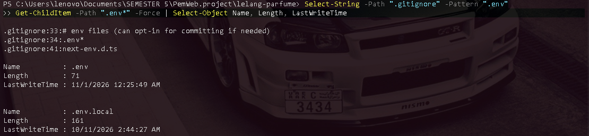
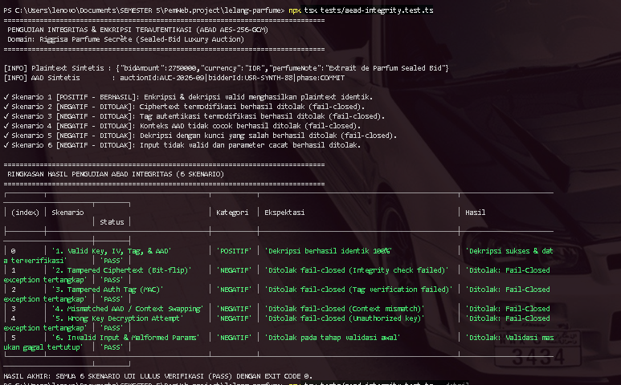
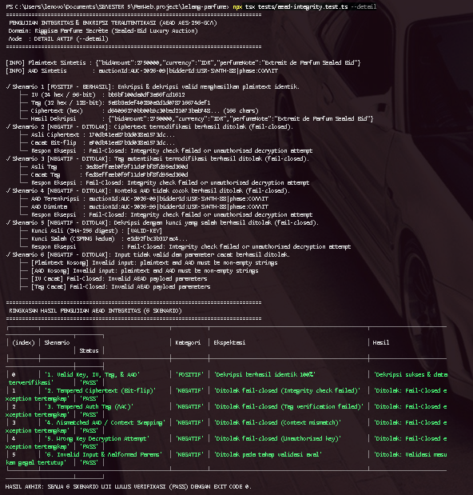

# KEPUTUSAN.md — Dokumentasi Desain Kriptografi

**Proyek:** Riggisa Parfume Secrète (Aplikasi Lelang Parfum Berbasis Sealed-Bid)
**Mata Kuliah:** Kriptografi — Tugas 2: Enkripsi Terautentikasi dan Integritas Data
**Milestone Tag:** `v0.2`

Dokumen teknis ini mendokumentasikan pemenuhan Rubrik R2 (K1, K2, K3, K4) pada implementasi skema Authenticated Encryption with Associated Data (AEAD) berbasis **AES-256-GCM** yang mengikat konteks lelang parfum.

---

## 1. Pemetaan Kebutuhan -> Mekanisme -> Alasan (K1)

| Aspek | Deskripsi / Penjelasan |
|---|---|
| **Kebutuhan** | Melindungi kerahasiaan nominal tawaran (*sealed-bid*) dan data sensitif penawar pada aplikasi Riggisa Parfume Secrète sekaligus menjamin keaslian serta integritas data dari manipulasi pihak ketiga maupun serangan pertukaran konteks (*replay/context-swapping attack*) antar-lelang. |
| **Mekanisme** | Mengadopsi skema *Authenticated Encryption with Associated Data* (AEAD) menggunakan algoritma **AES-256-GCM** melalui pustaka modul standar terawat `node:crypto` (berbasis OpenSSL *native backend*). |
| **Alasan Pemilihan** | • **Atomisitas Keamanan:** AES-256-GCM menyatukan enkripsi simetris (*Counter Mode*) dan autentikasi pesan (*Galois Message Authentication Code / GMAC*) dalam satu operasi atomik.<br>• **Pengikatan Konteks Eksplisit (AAD):** Mendukung pengikatan metadata konteks penawaran tanpa perlu mengenkripsi data publik tersebut, mencegah ciphertext disalahgunakan pada lelang berbeda.<br>• **Performa Tinggi:** Mendukung akselerasi perangkat keras instruksi prosesor (AES-NI dan CLMUL/PCLMULQDQ).<br>• **Bebas Kerentanan Padding:** Beroperasi sebagai *stream cipher mode*, mengeliminasi kerentanan *padding oracle attacks* yang sering menimpa mode rantai blok konvensional seperti AES-CBC. |

---

## 2. Spesifikasi Parameter Kriptografi (K2)

Implementasi parameter AEAD pada `lib/crypto.ts` mengikuti standar NIST SP 800-38D:

* **Algoritma:** `aes-256-gcm` melalui modul bawaan `node:crypto`.
* **Panjang Kunci:** 256-bit (32 byte), diturunkan dari secret CSPRNG minimal 32 karakter menggunakan fungsi deterministik SHA-256 atau dimuat langsung jika berupa format 64 karakter hex CSPRNG.
* **Initialization Vector (IV) / Nonce:** 96-bit (12 byte), selalu dibangkitkan secara independen dan unik pada setiap operasi enkripsi menggunakan CSPRNG `crypto.randomBytes(12)`. IV direpresentasikan dalam bentuk 24 karakter heksadesimal.
* **Additional Authenticated Data (AAD):** Mengikat identitas domain lelang parfum secara kontekstual:
  ```text
  auctionId:<ID>|bidderId:<ID>|phase:<PHASE>
  ```
  Data ini dimasukkan sebagai UTF-8 byte buffer ke dalam perhitungan Galois Message Authentication Tag (`cipher.setAAD()`), menjamin ciphertext tidak dapat dipindahkan ke lelang, penawar, atau fase lelang lain tanpa membatalkan tag autentikasi.
* **Authentication Tag (MAC):** 128-bit (16 byte), dikunci secara eksplisit melalui opsi `{ authTagLength: 16 }` pada `createCipheriv` dan `createDecipheriv`. Tag direpresentasikan dalam bentuk 32 karakter heksadesimal.

---

## 3. Manajemen Kunci, Validasi Masukan, dan Prinsip Gagal Tertutup / Fail-Closed (K3)

### Pembangkitan & Penyimpanan Kunci
1. **Pembangkitan Kunci:** Kunci master dibangkitkan menggunakan CSPRNG berspesifikasi tinggi:
   ```bash
   node -e "console.log(require('crypto').randomBytes(32).toString('hex'))"
   ```
2. **Penyimpanan di Luar Kode:** Kunci disimpan secara ketat di luar repository pada file `.env` / `.env.local` melalui variabel lingkungan `ENCRYPTION_SECRET`. File ini diproteksi oleh `.gitignore` dan `.dockerignore` sehingga tidak pernah tercatat di Git history maupun container build context.
3. **Penyediaan Kunci Pengujian:** Script pengujian mandiri membangkitkan kunci sintetis acak di memori proses lokal sehingga tidak ada secret statis produksi yang dibutuhkan atau dibocorkan saat pengujian.



### Validasi Masukan & Prinsip Fail-Closed
1. **Validasi Masukan Pra-Eksekusi:**
   * Plaintext dan AAD wajib bertipe string dan tidak boleh kosong. Input kosong langsung melempar exception `Error("Invalid input: plaintext and AAD must be non-empty strings")`.
   * Struktur payload wajib memiliki properti `iv`, `ciphertext`, `tag`, dan `aad`.
   * Panjang IV wajib tepat 24 karakter hex (12 byte).
   * Panjang Auth Tag wajib tepat 32 karakter hex (16 byte).
   * Format IV, Tag, dan Ciphertext divalidasi heksadesimal genap. Jika tidak valid, dilempar `Error("Fail-Closed: Invalid AEAD payload parameters")`.
2. **Fail-Closed saat Modifikasi/Serangan:**
   * Jika bit ciphertext diubah, authentication tag diubah, AAD diubah, atau kunci dekripsi tidak cocok, `decipher.final()` pada `aes-256-gcm` akan memicu kegagalan autentikasi GMAC.
   * Modul menangkap error internal dan langsung melempar error umum tertutup:
     ```text
     Fail-Closed: Integrity check failed or unauthorized decryption attempt
     ```
   * Tidak ada potongan data dekripsi parsial atau pesan error internal OpenSSL yang dibocorkan ke pemanggil.

---

## 4. Ringkasan Skenario Uji & Respons Kondisi Tidak Sah (K4)

Pengujian integritas dan prinsip gagal-tertutup diimplementasikan pada file pengujian mandiri `tests/aead-integrity.test.ts`.

### Perintah Menjalankan Pengujian
```bash
# Mode Ringkas
npx tsx tests/aead-integrity.test.ts

# Mode Detail (Parameter Heksadesimal & Pelacakan Eksepsi Fail-Closed)
npx tsx tests/aead-integrity.test.ts --detail
```

### Folder Bukti Pengujian
File screenshot hasil pengujian ditempatkan pada direktori:
```text
crypto/bukti_tugas2/
```

### Tabel Ringkasan Skenario Uji

| No | Skenario Uji | Kategori | Kondisi Masukan Uji | Perilaku & Respons Sistem | Status |
|:--:|---|:---:|---|---|:---:|
| **1** | Valid Key, IV, Tag, & AAD | **POSITIF** | Plaintext lelang sintetis, AAD lelang valid, kunci CSPRNG valid | Ciphertext terenkripsi dengan IV 96-bit dan Tag 128-bit. Dekripsi berhasil dan menghasilkan plaintext yang 100% identik. | **PASS** |
| **2** | Tampered Ciphertext (Bit-flip) | **NEGATIF** | 1 bit pada karakter pertama ciphertext diubah (*bit-flipping*) | GMAC mendeteksi anomali integritas; melempar exception `Fail-Closed: Integrity check failed or unauthorized decryption attempt`. | **PASS** |
| **3** | Tampered Auth Tag (MAC) | **NEGATIF** | Karakter pertama authentication tag diubah | Verifikasi tag autentikasi gagal total; melempar exception `Fail-Closed: Integrity check failed or unauthorized decryption attempt`. | **PASS** |
| **4** | Mismatched AAD / Context Swapping | **NEGATIF** | Ciphertext didekripsi dengan AAD lelang berbeda (`AUC-2026-99`) | Pengikatan konteks AAD tidak cocok; melempar exception `Fail-Closed: Integrity check failed or unauthorized decryption attempt`. Mencegah serangan pemindahan bid antar-lelang. | **PASS** |
| **5** | Wrong Key Decryption Attempt | **NEGATIF** | Payload valid didekripsi menggunakan kunci CSPRNG kedua yang berbeda | Verifikasi autentikasi gagal karena kunci tidak cocok; melempar exception `Fail-Closed: Integrity check failed or unauthorized decryption attempt`. | **PASS** |
| **6** | Invalid Input & Malformed Params | **NEGATIF** | Plaintext kosong, AAD kosong, IV cacat (bukan 24 hex), Tag cacat (bukan 32 hex) | Ditolak pada tahap pra-validasi sebelum operasi kriptografi dijalankan (`Invalid input...` atau `Fail-Closed: Invalid AEAD payload parameters`). | **PASS** |

### Bukti Screenshot Pengujian




