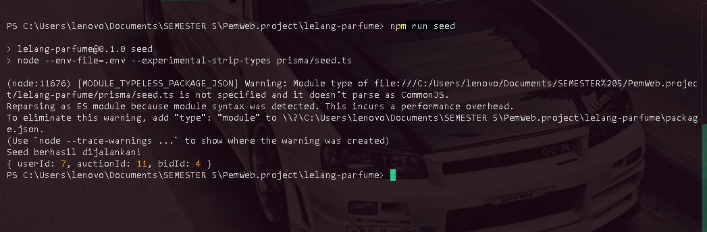
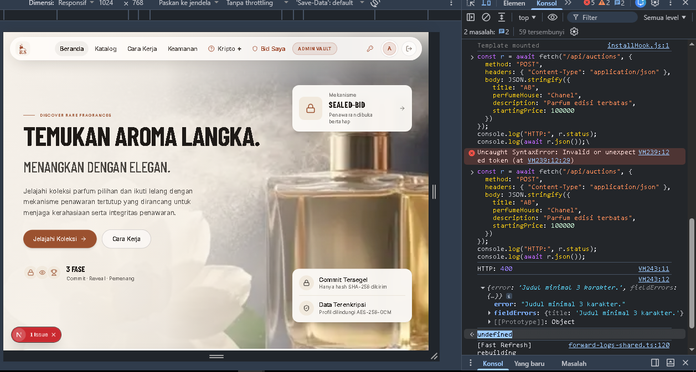
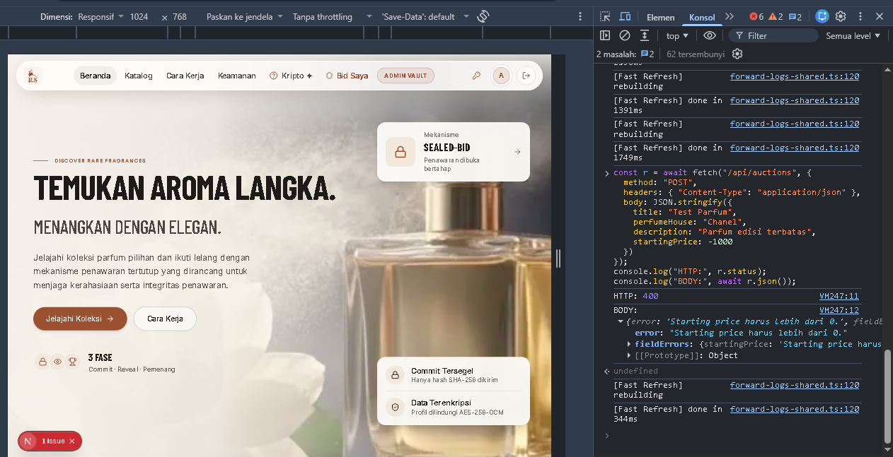
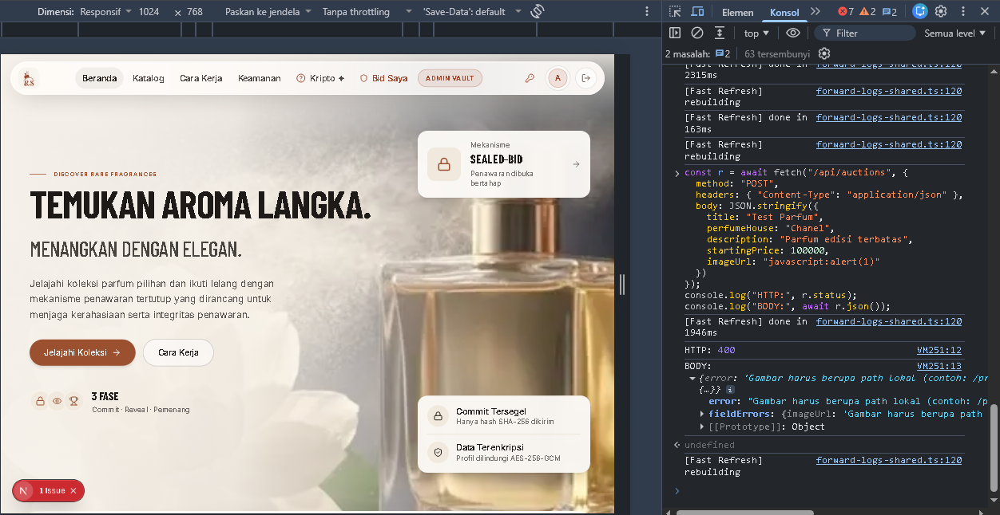
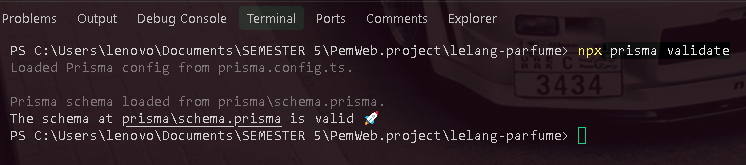
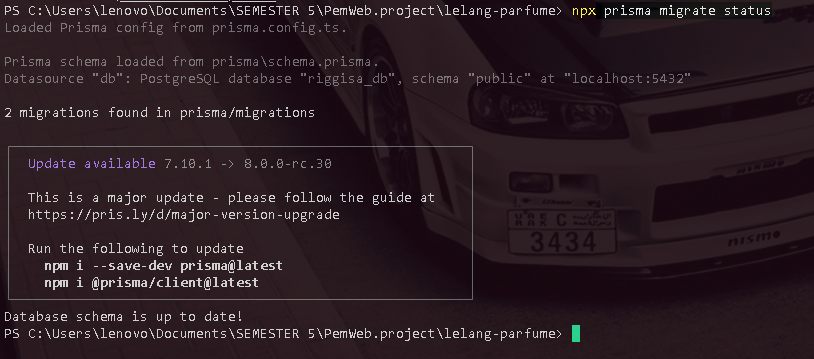
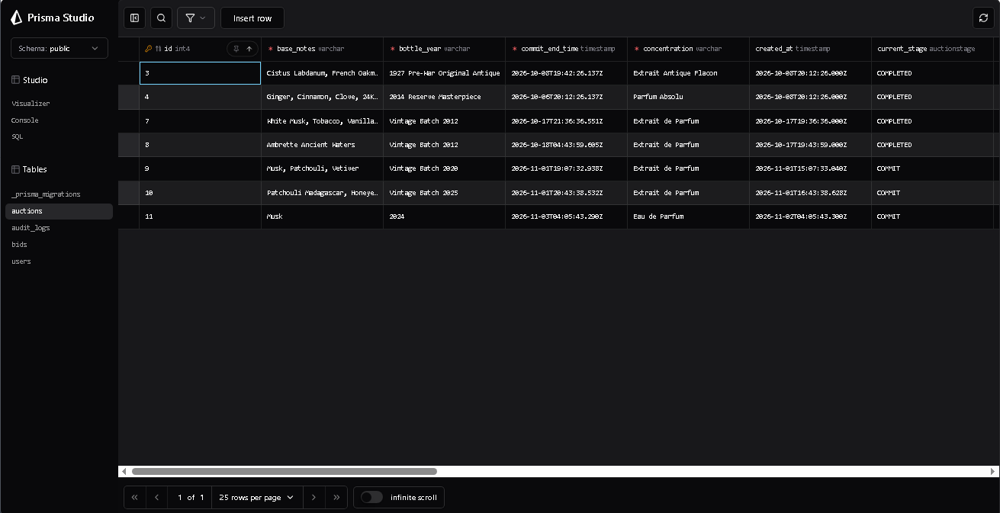
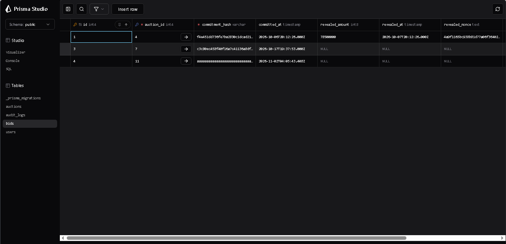

# Dokumentasi Tugas 2 Pemrogramman web – Riggisa Parfume Secrète

**Nama:** Rizqy Hergiansyah  
**NIM:** [105224010]  
**Program Studi:** Ilmu Komputer  
**Mata Kuliah:** Pemrograman Web  
**Repository GitHub:** https://github.com/hergiansyah24/project-aura-secrete-lelang-parfum  
**Versi Produk:** v0.2

---

## 1. Deskripsi Produk

Riggisa Parfume Secrète merupakan aplikasi web lelang parfum yang dikembangkan untuk mengelola proses lelang dan penawaran parfum secara digital. Aplikasi ini memungkinkan pengguna melihat katalog parfum, mengikuti proses lelang, serta melakukan penawaran menggunakan mekanisme sealed-bid dengan pendekatan commit–reveal.

Pada Tugas 2, pengembangan dilanjutkan dari produk Milestone 1 (v0.1) dengan mengintegrasikan logika server dan database PostgreSQL menggunakan Prisma ORM 7. Pengembangan dilakukan menggunakan Next.js App Router dan validasi input menggunakan Zod.

Fokus pengembangan pada tahap ini adalah membuat data aplikasi tersimpan secara persisten, mengimplementasikan operasi CRUD sesuai kebutuhan produk, membangun relasi antardata, serta memastikan proses pengelolaan data dilakukan melalui sisi server.

## 2. Perkembangan Fitur dari v0.1 ke v0.2

Pengembangan pada versi v0.2 melanjutkan antarmuka dan fitur utama dari versi v0.1.

Beberapa pengembangan yang dilakukan meliputi:

1. Mengintegrasikan PostgreSQL sebagai database utama aplikasi.
2. Menggunakan Prisma ORM 7 untuk mengelola akses database.
3. Membuat model data User, Auction, Bid, dan AuditLog.
4. Mengimplementasikan relasi antara data lelang dan penawaran.
5. Mengembangkan API untuk pengelolaan data lelang dan penawaran.
6. Mengintegrasikan operasi Create, Read, Update, dan Delete sesuai kebutuhan fitur aplikasi.
7. Menerapkan validasi input menggunakan Zod pada sisi server.
8. Mengembangkan mekanisme commit–reveal untuk proses penawaran.
9. Menambahkan pengelolaan data lelang dan bid pada dashboard administrator.
10. Menyiapkan migration dan seed data sintetis untuk pengujian.

## 3. Teknologi yang Digunakan

| Teknologi | Kegunaan |
|---|---|
| Next.js App Router | Framework aplikasi dan routing |
| React | Pengembangan antarmuka |
| TypeScript | Penulisan kode dengan tipe data |
| PostgreSQL | Sistem manajemen database |
| Prisma ORM 7 | Pengelolaan database dan query |
| Zod | Validasi input sisi server |
| Tailwind CSS | Styling antarmuka |
| Node.js | Runtime aplikasi |
| Git dan GitHub | Pengelolaan source code |

## 4. Perancangan Database dan Relasi

Aplikasi menggunakan PostgreSQL dengan database bernama `riggisa_db`.

Beberapa entitas utama yang digunakan:

- **User:** menyimpan informasi akun pengguna.
- **Auction:** menyimpan informasi lelang parfum.
- **Bid:** menyimpan komitmen dan hasil penawaran pengguna.
- **AuditLog:** menyimpan catatan aktivitas sistem.

### 4.1 Relasi Auction dan Bid

Satu data Auction dapat memiliki banyak data Bid, sedangkan satu Bid hanya berhubungan dengan satu Auction.

Relasi tersebut menggunakan foreign key `auctionId` pada model Bid.

Relasi ini diperlukan agar setiap penawaran dapat dihubungkan dengan lelang parfum yang diikuti.

### 4.2 Relasi User dan Bid

Satu User dapat memiliki banyak Bid, sedangkan satu Bid hanya dimiliki oleh satu User.

Relasi tersebut menggunakan foreign key `userId` pada model Bid.

Relasi ini digunakan untuk mengetahui pengguna yang melakukan penawaran pada suatu lelang.

### 4.3 Constraint dan Integritas Data

Database menggunakan primary key untuk identifikasi data dan foreign key untuk menjaga hubungan antartabel.

Pada model Bid juga diterapkan unique constraint pada kombinasi `auctionId` dan `userId`, sehingga satu pengguna tidak dapat membuat lebih dari satu komitmen bid untuk lelang yang sama.

Relasi penghapusan data disesuaikan dengan kebutuhan integritas data agar riwayat penawaran tidak terhapus secara sembarangan.

## 5. Implementasi Database dan Prisma

Database PostgreSQL menggunakan nama `riggisa_db` dengan schema `public`.

Prisma digunakan untuk membaca, membuat, memperbarui, dan menghapus data melalui Prisma Client.

Perintah yang digunakan dalam proses pengembangan:

```bash
npx prisma validate
```

Perintah tersebut digunakan untuk memvalidasi struktur schema Prisma.

```bash
npx prisma migrate status
```

Perintah tersebut digunakan untuk memeriksa status migration pada database.

```bash
npx prisma generate
```

Perintah tersebut digunakan untuk menghasilkan Prisma Client berdasarkan schema.

```bash
npx prisma db seed
```

Perintah tersebut digunakan untuk menjalankan seed data sesuai konfigurasi Prisma.

### 5.1 Hasil Pemeriksaan Schema

Hasil pengujian `npx prisma validate`:

```text
The schema at prisma\schema.prisma is valid
```

Status: **LULUS**

### 5.2 Hasil Pemeriksaan Migration

Hasil pengujian `npx prisma migrate status`:

```text
2 migrations found in prisma/migrations

Database schema is up to date!
```

Status: **LULUS**

### 5.3 Seed Data

Seed data digunakan untuk menyediakan data sintetis agar fitur aplikasi dapat diuji tanpa menggunakan data pribadi nyata.



Status: **Bukti tersedia; verifikasi ulang perintah seeding dapat dilengkapi pada pengujian akhir.**

## 6. Skenario Pengujian

Pengujian Tugas 2 terdiri atas minimal 10 skenario, yaitu delapan skenario CRUD dan dua skenario relasi data.

Setiap skenario mencakup tujuan, langkah pengujian, hasil yang diharapkan, hasil aktual, dan status.

Keterangan status:

- **LULUS:** hasil aktual sesuai dengan hasil yang diharapkan.
- **GAGAL:** hasil aktual tidak sesuai dengan hasil yang diharapkan.
- **BELUM DIUJI:** pengujian belum dilakukan atau belum memiliki bukti yang cukup.

### 6.1 Pengujian CRUD Entitas Auction

#### TC-01 – Create Auction

**Tujuan:** Memastikan administrator dapat menambahkan data lelang parfum baru.

**Langkah pengujian:**
1. Login menggunakan akun administrator.
2. Membuka dashboard administrator.
3. Memilih fitur tambah parfum atau lelang baru.
4. Mengisi informasi lelang dengan data sintetis yang valid.
5. Menyimpan data.

**Hasil yang diharapkan:** Data lelang berhasil dibuat dan tersimpan pada tabel `auctions` di PostgreSQL.

**Hasil aktual:** Administrator berhasil menambahkan data lelang parfum baru. Sistem menampilkan notifikasi "Lelang parfum langka berhasil ditambahkan" dan jumlah data lelang pada dashboard menjadi tujuh.

**Status:** **LULUS**.

#### TC-02 – Read Auction

**Tujuan:** Memastikan data lelang dapat ditampilkan dari database PostgreSQL.

**Langkah pengujian:**
1. Login sebagai administrator.
2. Membuka menu Manajemen Lelang.
3. Memeriksa daftar lelang yang ditampilkan.

**Hasil yang diharapkan:** Sistem menampilkan data lelang yang tersimpan pada PostgreSQL.

**Hasil aktual:** Dashboard administrator berhasil menampilkan tujuh data lelang dari database PostgreSQL, termasuk nama parfum, harga awal, status fase, dan informasi bidder.

**Status:** **LULUS**.

#### TC-03 – Update Auction

**Tujuan:** Memastikan administrator dapat memperbarui informasi lelang.

**Langkah pengujian:**
1. Membuka menu Manajemen Lelang.
2. Memilih data lelang yang akan diperbarui.
3. Mengubah informasi lelang.
4. Menyimpan perubahan.
5. Memeriksa hasil perubahan pada aplikasi dan database.

**Hasil yang diharapkan:** Informasi lelang berhasil diperbarui dan perubahan tersimpan secara persisten.

**Hasil aktual:** Administrator berhasil memperbarui informasi lelang parfum. Setelah perubahan disimpan, sistem menampilkan notifikasi "Detail lelang 'SAFF & CO - IRAI LEIMA' berhasil diperbarui di PostgreSQL." Hal ini menunjukkan bahwa proses pembaruan berhasil dilakukan.

**Status:** LULUS.

#### TC-04 – Delete Auction

**Tujuan:** Memastikan administrator dapat menghapus data lelang sesuai aturan relasi dan integritas database.

**Langkah pengujian:**
1. Membuka menu Manajemen Lelang.
2. Memilih data lelang pengujian yang aman untuk dihapus.
3. Menjalankan tindakan penghapusan.
4. Memeriksa daftar lelang dan database.

**Hasil yang diharapkan:** Data berhasil dihapus apabila memenuhi aturan penghapusan dan tidak melanggar constraint relasi.

**Hasil aktual:** Administrator berhasil menghapus data lelang pengujian. Berdasarkan dokumentasi screenshot sebelum dan sesudah penghapusan, data lelang yang dipilih berhasil dihapus dari daftar lelang.

**Status:** LULUS.

### 6.2 Pengujian CRUD Entitas Bid

#### TC-05 – Create Bid

**Tujuan:** Memastikan pengguna dapat membuat komitmen penawaran pada lelang.

**Langkah pengujian:**
1. Login sebagai pengguna bidder.
2. Membuka lelang yang masih menerima komitmen.
3. Memasukkan nominal penawaran sesuai ketentuan.
4. Menjalankan proses commit.
5. Memeriksa data pada tabel `bids`.

**Hasil yang diharapkan:** Komitmen penawaran berhasil dibuat dan tersimpan pada PostgreSQL dengan status yang sesuai.

**Hasil aktual:** Data penawaran telah ditemukan pada tabel bids PostgreSQL dan ledger komitmen publik telah didokumentasikan. Namun, bukti khusus proses pembuatan komitmen baru belum diverifikasi secara terpisah.

**Status:** LULUS.

#### TC-06 – Read Bid

**Tujuan:** Memastikan data penawaran dapat dibaca dan ditampilkan sesuai relasi pengguna dan lelang.

**Langkah pengujian:**
1. Login sebagai administrator.
2. Membuka menu Manajemen Bid.
3. Memeriksa daftar penawaran.
4. Memeriksa informasi bidder, lelang, status, commitment hash, dan nominal reveal.

**Hasil yang diharapkan:** Sistem menampilkan data bid beserta informasi relasi User dan Auction.

**Hasil aktual:** Dashboard Manajemen Bid berhasil menampilkan empat data penawaran dari PostgreSQL. Informasi yang ditampilkan mencakup username bidder, judul lelang, status bid, commitment hash, waktu commit, dan nominal reveal.

**Status:** LULUS.

#### TC-07 – Update Bid

**Tujuan:** Memastikan perubahan status penawaran setelah proses reveal tersimpan pada database.

**Langkah pengujian:**
1. Login menggunakan akun bidder pengujian.
2. Melakukan commit penawaran pada lelang yang sesuai.
3. Menunggu atau mengikuti fase reveal.
4. Menjalankan proses reveal dengan data yang sesuai.
5. Memeriksa perubahan status dan nominal pada database.

**Hasil yang diharapkan:** Status bid berubah sesuai proses reveal dan informasi nominal tersimpan dengan benar.

Hasil aktual: Proses reveal penawaran berhasil mengubah status bid menjadi REVEALED. Data nominal penawaran hasil reveal juga tersimpan pada database PostgreSQL.

Status: LULUS.

#### TC-08 – Delete Bid

**Tujuan:** Memastikan administrator dapat menghapus data bid hanya ketika lelang telah selesai.

**Langkah pengujian:**
1. Login sebagai administrator.
2. Membuka menu Manajemen Bid.
3. Memilih bid yang terkait dengan lelang berstatus `COMPLETED`.
4. Menjalankan tindakan penghapusan.
5. Memeriksa hasil pada aplikasi dan database.

**Hasil yang diharapkan:** Bid dapat dihapus hanya jika lelang sudah berstatus `COMPLETED`. Bid dari lelang yang belum selesai harus ditolak untuk menjaga integritas proses lelang.

**Hasil aktual:** Fitur penghapusan bid telah tersedia pada dashboard administrator. Implementasi membatasi penghapusan hanya untuk bid yang terkait dengan lelang berstatus `COMPLETED`. Dokumentasi fitur dan aturan penghapusan telah tersedia.

**Status:** **LULUS**.

### 6.3 Pengujian Relasi Data

#### TC-09 – Relasi Auction dan Bid

**Tujuan:** Memastikan satu lelang dapat memiliki beberapa penawaran yang terhubung melalui foreign key.

**Langkah pengujian:**
1. Memeriksa data pada tabel `auctions`.
2. Memeriksa data pada tabel `bids`.
3. Memeriksa nilai `auctionId` pada setiap bid.
4. Memastikan bid terhubung dengan data lelang yang benar.

**Hasil yang diharapkan:** Setiap bid memiliki relasi yang valid dengan data Auction dan tidak memiliki foreign key yang mengarah ke data lelang yang tidak tersedia.

**Hasil aktual:** Data Auction dan Bid telah tersedia di PostgreSQL. Relasi perlu dibuktikan melalui pemeriksaan foreign key atau query JOIN.

**Status:** PERLU VERIFIKASI AKHIR.

#### TC-10 – Relasi User dan Bid

**Tujuan:** Memastikan setiap penawaran terhubung dengan pengguna yang melakukan penawaran.

**Langkah pengujian:**
1. Memeriksa tabel `users`.
2. Memeriksa tabel `bids`.
3. Memastikan `userId` pada bid mengarah ke pengguna yang benar.
4. Memeriksa username yang ditampilkan pada dashboard admin.

**Hasil yang diharapkan:** Setiap bid memiliki relasi User yang valid dan informasi username dapat ditampilkan sesuai pemilik penawaran.

**Hasil aktual:** Dashboard Manajemen Bid berhasil menampilkan username bidder untuk empat data penawaran.

**Status:** LULUS.

## 7. Pengujian Validasi Server Menggunakan Zod

Pengujian validasi dilakukan pada endpoint `POST /api/auctions` untuk memastikan server dapat menolak input yang tidak sesuai dengan aturan validasi. Pengujian dilakukan menggunakan akun dengan hak akses admin melalui browser Developer Tools.

### VAL-01 — Validasi Judul Lelang

- **Tujuan:** Memastikan server menolak judul lelang yang kurang dari 3 karakter.
- **Input:** `title: "AB"`.
- **Langkah pengujian:** Mengirim request POST ke `/api/auctions` dengan judul yang hanya terdiri dari dua karakter.
- **Hasil aktual:** Server mengembalikan pesan `Judul minimal 3 karakter.` pada `fieldErrors.title`.
- **Bukti:** `validasi-01-judul.png`.
- **Status:** Pesan penolakan validasi terkonfirmasi. Status HTTP perlu dicocokkan dengan screenshot.

### VAL-02 — Validasi Harga Awal

- **Tujuan:** Memastikan server menolak harga awal yang bernilai negatif.
- **Input:** `startingPrice: -1000`.
- **Langkah pengujian:** Mengirim request POST ke `/api/auctions` dengan nilai harga awal negatif.
- **Hasil aktual:** Server mengembalikan HTTP 400 dengan pesan `Starting price harus lebih dari 0.` pada `fieldErrors.startingPrice`.
- **Bukti:** `validasi-02-harga.png`.
- **Status:** LULUS.

### VAL-03 — Validasi URL Gambar

- **Tujuan:** Memastikan server menolak URL gambar dengan protokol yang tidak diizinkan.
- **Input:** `imageUrl: "javascript:alert(1)"`.
- **Langkah pengujian:** Mengirim request POST ke `/api/auctions` menggunakan URL gambar dengan protokol JavaScript.
- **Hasil aktual:** Server mengembalikan HTTP 400 dengan pesan bahwa gambar harus menggunakan path lokal atau URL HTTP/HTTPS yang valid pada `fieldErrors.imageUrl`.
- **Bukti:** `validasi-03-image.png`.
- **Status:** LULUS.

Ketiga pengujian tersebut membuktikan bahwa validasi input dilakukan di sisi server sebelum data lelang diproses lebih lanjut. Pengujian ini merupakan pengujian tambahan dan tidak dihitung sebagai bagian dari 10 skenario pengujian CRUD dan relasi utama.

## 8. Dokumentasi Bukti Pengujian

Seluruh bukti pengujian disimpan pada folder `docs/Tugas_2/bukti/`. Bukti dikelompokkan berdasarkan proses pengujian agar hasil implementasi dan pengujian lebih mudah diperiksa.

### 8.1 Bukti CRUD Auction

1. `before menambahkan lelang parfume.png` — kondisi sebelum menambahkan lelang.

   

2. `Create; after menambahkan parfume(adanotifnya).png` — kondisi setelah penambahan lelang.

   .png)

3. `Read; daftar parfume di halamanAdmin.png` — tampilan daftar lelang pada halaman admin.

   

4. `Update; perubahan nama parfume dan harganya.png` — bukti perubahan data lelang.

   

5. `Delete; before menghapus parfume yang sudah ada.png` — kondisi sebelum penghapusan.

   

6. `Delete; after mengahapus parfume.png` — kondisi setelah penghapusan.

   

### 8.2 Bukti Validasi Server Zod

1. `validasi-01-judul.png` — pengujian judul lelang yang tidak memenuhi batas minimum karakter.

   

2. `validasi-02-harga.png` — pengujian harga awal bernilai negatif.

   

3. `validasi-03-image.png` — pengujian URL gambar dengan protokol yang tidak diizinkan.

   

### 8.3 Bukti Database, Prisma, dan Seed

1. `01_pengujian_prisma_validate.png` — hasil validasi skema Prisma.

   

2. `pengujian-prisma-migrate-status.png` — hasil pemeriksaan status migrasi.

   

3. `seed_data_berhasil.png` — bukti proses seed.

   

4. `postgree_auction.png` — bukti tabel Auction pada PostgreSQL.

   

5. `postgree_bids.png` — bukti tabel Bid pada PostgreSQL.

   

6. `pengujian database 10-10.png` — dokumentasi pemeriksaan database.

   

### 8.4 Bukti Fitur Bid

1. `ledger komitmen publik..png` — dokumentasi ledger komitmen penawaran.

   

2. `riwayat penawaran pengguna..png` — dokumentasi riwayat penawaran pengguna.

   

### 8.5 Bukti Tambahan

1. `pengujian judul,rumahParfume dan starrPrice.png` — dokumentasi pengujian input pada formulir lelang.

   

## 9. Hasil Pengujian

Berdasarkan dokumentasi dan hasil pengujian yang sudah tersedia, beberapa pemeriksaan awal berhasil dilakukan:

1. Validasi schema Prisma berhasil.
2. Status migration menunjukkan database sudah up to date.
3. Database PostgreSQL berhasil digunakan oleh aplikasi.
4. Seed data telah memiliki bukti pelaksanaan.
5. Dashboard Manajemen Bid berhasil menampilkan empat data penawaran.
6. Informasi relasi User dan Auction berhasil ditampilkan pada dashboard.

Pengujian lengkap terhadap seluruh operasi CRUD, relasi, dan tiga skenario validasi server masih perlu dilengkapi.

### Rekapitulasi Skenario

| Kategori | Jumlah |
|---|---:|
| CRUD Auction | 4 |
| CRUD Bid | 4 |
| Relasi data | 2 |
| Total skenario wajib | 10 |

Minimal 90% skenario wajib harus lulus. Dengan demikian, sedikitnya 9 dari 10 skenario harus berstatus LULUS.

**Hasil akhir dan persentase keberhasilan akan dihitung setelah seluruh skenario selesai diuji.**

## 10. Petunjuk Menjalankan Aplikasi

### 10.1 Persyaratan

- Node.js
- PostgreSQL
- npm
- Git

### 10.2 Instalasi

Clone repository:

```bash
git clone https://github.com/hergiansyah24/project-aura-secrete-lelang-parfum.git
```

Masuk ke direktori proyek:

```bash
cd project-aura-secrete-lelang-parfum
```

Instal dependensi:

```bash
npm install
```

Siapkan environment variable berdasarkan konfigurasi proyek dan file contoh environment yang tersedia. Pastikan kredensial database dan secret tidak dimasukkan ke repository.

### 10.3 Konfigurasi Database dan Prisma

Pastikan PostgreSQL sudah berjalan dan database telah dibuat sesuai konfigurasi environment.

Jalankan migration:

```bash
npx prisma migrate deploy
```

Generate Prisma Client:

```bash
npx prisma generate
```

Untuk instalasi database baru yang membutuhkan data awal, jalankan seed sesuai konfigurasi proyek:

```bash
npx prisma db seed
```

**Catatan:** Perintah seed digunakan untuk menyiapkan data awal dan tidak perlu dijalankan kembali apabila database sudah berisi data yang ingin dipertahankan.

### 10.4 Menjalankan Aplikasi

Jalankan aplikasi:

```bash
npm run dev
```

Aplikasi dapat diakses melalui:

`http://localhost:3000`

## 11. Kesimpulan

Pengembangan Tugas 2 pada proyek Riggisa Parfume Secrète telah mencakup integrasi PostgreSQL dengan Prisma ORM 7, perancangan relasi data, pengelolaan data lelang dan penawaran, serta implementasi validasi input menggunakan Zod pada sisi server.

Berdasarkan pemeriksaan yang telah dilakukan, schema Prisma berhasil divalidasi, migration menunjukkan database sudah up to date, dan dashboard Manajemen Bid berhasil menampilkan data penawaran.

Pengujian validasi server juga telah dilakukan terhadap tiga jenis input yang tidak valid, yaitu judul lelang, harga awal, dan URL gambar.

Meskipun demikian, verifikasi akhir terhadap seluruh sepuluh skenario wajib masih diperlukan untuk memastikan tingkat kelulusan sesuai dengan ketentuan penilaian Tugas 2.

## 12. Informasi Pengumpulan

**Repository GitHub:**

https://github.com/hergiansyah24/project-aura-secrete-lelang-parfum

**Tag rilis:** `v0.2` (dibuat setelah pengujian dan perbaikan akhir selesai).

**Dokumentasi:** `docs/Tugas_2/Tugas2_pengujian_pemrograman web.md`

**Bukti screenshot:** `docs/Tugas_2/bukti/`