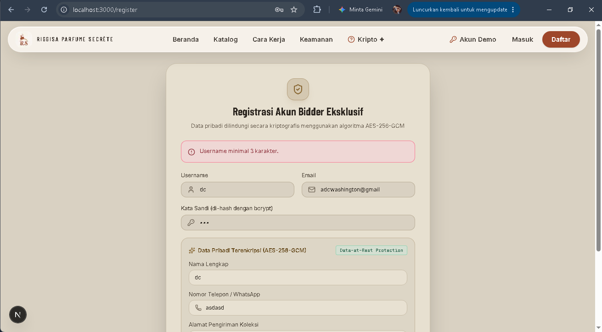
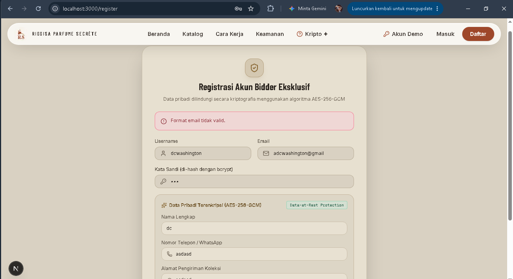

# Dokumen Teknis Modul 5 Formulir, Validasi, Session, dan Cookie

**Nama/NIM:** Rizqy Hergiansyah / [105224010]  
**Repositori:** https://github.com/hergiansyah24/project-aura-secrete-lelang-parfum

## 1. Skema Validasi

Skema validasi digunakan untuk memastikan bahwa data yang dimasukkan pengguna sudah sesuai dengan aturan sebelum diproses oleh server. Pada modul ini, validasi dirancang menggunakan pustaka **Zod 4**. Validasi dilakukan untuk memeriksa tipe data, panjang karakter, pilihan kategori, dan nilai checkbox.

### 1.1 Tabel Aturan Validasi

| Nama Kolom | Aturan Validasi Zod | Pesan Galat |
|---|---|---|
| `judul` | Bertipe string, spasi di awal dan akhir dihapus menggunakan `trim()`, panjang minimal 3 karakter dan maksimal 80 karakter. | Judul parfum minimal 3 karakter. / Judul parfum maksimal 80 karakter. |
| `kategori` | Harus memilih salah satu kategori yang telah ditentukan menggunakan `z.enum()`. | Pilih kategori parfum yang tersedia. |
| `deskripsi` | Bertipe string, menggunakan `trim()`, panjang minimal 10 karakter dan maksimal 300 karakter. | Deskripsi minimal 10 karakter. / Deskripsi maksimal 300 karakter. |
| `tersedia` | Nilai checkbox dikonversi menjadi boolean menggunakan `z.stringbool()` dan memiliki nilai bawaan `false`. | Nilai checkbox tidak valid. |

### 1.2 Implementasi Skema Zod 4

Skema validasi dapat didefinisikan dalam berkas `lib/skema.ts`. Berikut contoh implementasinya:

```typescript
import { z } from "zod";

export const skemaItem = z.object({
  judul: z
    .string()
    .trim()
    .min(3, "Judul parfum minimal 3 karakter.")
    .max(80, "Judul parfum maksimal 80 karakter."),

  kategori: z.enum(["Designer", "Niche", "Lokal"], {
    error: "Pilih kategori parfum yang tersedia.",
  }),

  deskripsi: z
    .string()
    .trim()
    .min(10, "Deskripsi minimal 10 karakter.")
    .max(300, "Deskripsi maksimal 300 karakter."),

  tersedia: z.stringbool().default(false),
});

export type DataItem = z.infer<typeof skemaItem>;
```

**Catatan:** Kategori `Designer`, `Niche`, dan `Lokal` merupakan contoh pilihan kategori. Nilai tersebut harus disamakan dengan pilihan yang benar-benar digunakan pada formulir produk. Nama kolom dan aturan checkbox juga perlu disesuaikan dengan implementasi formulir yang sebenarnya.

### 1.3 Validasi Semantik di Server

Selain memeriksa format dan tipe data, server perlu melakukan validasi semantik. Validasi semantik memeriksa apakah data memenuhi aturan bisnis aplikasi, bukan sekadar memiliki format yang benar.

Contoh aturan semantik pada formulir produk adalah **judul produk tidak boleh sama dengan judul produk yang sudah tersimpan di database**. Aturan ini diperlukan agar produk tidak tercatat dua kali dengan judul yang sama.

Pemeriksaan dilakukan di Server Action setelah data berhasil melewati validasi skema Zod. Server mengambil judul dari hasil validasi, kemudian memeriksa database untuk memastikan belum ada produk dengan judul yang sama. Jika ditemukan duplikasi, proses penyimpanan dihentikan dan server mengembalikan pesan galat yang sesuai.

Urutan validasi yang direncanakan adalah:

1. Memeriksa sesi pengguna dan hak akses jika tindakan memerlukan autentikasi.
2. Membaca data formulir dan memvalidasi bentuk data menggunakan skema Zod.
3. Memeriksa aturan semantik terhadap data yang tersimpan di database.
4. Menyimpan atau memperbarui data apabila seluruh pemeriksaan berhasil.

Dengan pembagian tersebut, Zod bertugas memeriksa struktur dan format masukan, sedangkan Server Action bertanggung jawab memeriksa aturan bisnis sebelum melakukan perubahan data.

## 2. Alur Server Action

Server Action digunakan untuk memproses data formulir di sisi server. Proses ini mencakup pemeriksaan sesi pengguna, validasi data menggunakan Zod, pemeriksaan aturan bisnis, dan penyimpanan data. Dengan pemrosesan di server, data tidak langsung dipercaya hanya karena sudah melewati validasi pada browser.

### 2.1 Urutan Proses Server Action

Alur pemrosesan formulir dirancang melalui tahapan berikut:

1. **Pemeriksaan sesi pengguna**

   Server memeriksa apakah pengguna sudah memiliki sesi yang valid dan memiliki hak akses untuk melakukan tindakan. Jika tindakan membutuhkan autentikasi dan sesi tidak valid, proses dihentikan.

2. **Validasi bentuk data**

   Data formulir dibaca menggunakan `FormData`, kemudian diperiksa dengan `safeParse()` berdasarkan skema Zod 4. Jika data tidak sesuai aturan, proses penyimpanan tidak dilanjutkan dan pesan galat dikembalikan ke formulir.

3. **Validasi semantik**

   Setelah bentuk data dinyatakan valid, server memeriksa aturan bisnis yang berkaitan dengan database. Contohnya, memeriksa apakah judul produk sudah digunakan agar tidak terjadi duplikasi data.

4. **Mutasi data**

   Jika seluruh validasi berhasil, server melakukan operasi database, seperti menambahkan atau memperbarui data produk.

5. **Pembaruan cache dan tampilan**

   Setelah data berhasil diubah, `revalidatePath()` dapat digunakan untuk memperbarui data pada rute yang terdampak agar halaman menampilkan informasi terbaru.

6. **Pengalihan halaman**

   Setelah proses berhasil, `redirect()` digunakan untuk mengarahkan pengguna ke halaman tujuan. Pemanggilan `redirect()` diletakkan di luar blok `try/catch` yang menangani kesalahan mutasi karena `redirect()` menghentikan alur eksekusi dengan mekanisme khusus Next.js.

### 2.2 Pembagian Berkas

Pembagian tanggung jawab berkas direncanakan sebagai berikut:

| Jenis Berkas | Tanggung Jawab |
|---|---|
| `lib/skema.ts` | Mendefinisikan skema validasi Zod 4 dan tipe data hasil validasi. |
| Server Component, misalnya `app/.../page.tsx` | Menampilkan halaman dan formulir dari sisi server serta menyiapkan data awal yang diperlukan. |
| Client Component, misalnya komponen formulir | Mengelola interaksi formulir, menggunakan `useActionState`, menampilkan pesan galat per kolom, dan menampilkan status ketika proses sedang berlangsung. |
| Berkas Server Action, misalnya `schema/actions.ts` | Menjalankan validasi di server, memeriksa aturan bisnis, melakukan mutasi data, memperbarui rute, dan mengarahkan pengguna setelah proses berhasil. |

Nama dan lokasi berkas pada tabel di atas merupakan contoh struktur. Penempatannya harus disesuaikan dengan struktur aktual project.

### 2.3 Pengelolaan Pesan Galat

Server Action menggunakan hasil validasi Zod untuk menentukan apakah data dapat diproses. Jika validasi gagal, pesan galat dikembalikan agar dapat ditampilkan pada kolom formulir yang sesuai.

Pada Zod 4, pesan galat per kolom dapat diperoleh menggunakan:

```typescript
const hasil = skemaItem.safeParse(dataFormulir);

if (!hasil.success) {
  const galatKolom = z.flattenError(hasil.error).fieldErrors;

  return {
    errors: galatKolom,
    message: "Periksa kembali data yang dimasukkan.",
  };
}
```

Contoh tersebut menggambarkan cara memperoleh pesan galat per kolom. Bentuk nilai yang dikembalikan harus disesuaikan dengan tipe state yang digunakan oleh `useActionState` pada formulir.

### 2.4 Kesimpulan

Server Action menjadi bagian penting dalam pemrosesan formulir karena validasi di browser saja tidak cukup untuk menjamin keamanan data. Oleh sebab itu, pemeriksaan sesi, validasi Zod, validasi semantik, dan operasi database harus dilakukan di sisi server. `useActionState` membantu formulir menerima hasil pemrosesan dan menampilkan pesan galat kepada pengguna.

## 3. Bukti Uji Validasi

Pengujian validasi dilakukan untuk memastikan bahwa server dapat menolak data yang tidak sesuai dengan aturan skema Zod 4 dan aturan bisnis aplikasi. Pengujian juga dilakukan dengan melewati validasi bawaan browser menggunakan atribut `novalidate` untuk memastikan bahwa server tetap memvalidasi data yang diterima.

### 3.1 Tabel Kasus Uji

| No. | Masukan / Skenario | Metode Pengujian | Hasil yang Diharapkan | Hasil Nyata |
|---|---|---|---|---|
| 1 | Judul kosong | Formulir normal | Data ditolak dan pesan galat judul ditampilkan. | Belum diuji |
| 2 | Judul hanya 2 karakter | `novalidate` | Server menolak data karena judul kurang dari 3 karakter. | Belum diuji |
| 3 | Judul lebih dari 80 karakter | `novalidate` | Server menolak data karena judul melebihi batas maksimal. | Belum diuji |
| 4 | Kategori diisi dengan nilai di luar pilihan yang ditentukan | Pengiriman data langsung atau `novalidate` | Server menolak kategori yang tidak termasuk nilai enum. | Belum diuji |
| 5 | Deskripsi kurang dari 10 karakter | Formulir normal | Data ditolak dan pesan galat deskripsi ditampilkan. | Belum diuji |
| 6 | Deskripsi lebih dari 300 karakter | `novalidate` | Server menolak data karena deskripsi melebihi batas maksimal. | Belum diuji |
| 7 | Judul sama dengan produk yang sudah tersimpan | Formulir dengan data duplikat | Server menolak penyimpanan jika aturan semantik tersebut diterapkan. | Belum diuji |
| 8 | Semua kolom diisi dengan data valid | Formulir normal | Data diterima dan disimpan jika pengguna memiliki hak akses yang sesuai. | Belum diuji |

**Catatan:** Skenario di atas mengacu pada contoh skema `skemaItem` di Nomor 1. Nama kolom, aturan, dan hasil yang diharapkan harus disesuaikan dengan formulir serta implementasi yang benar-benar digunakan dalam project. Kasus nomor 7 hanya berlaku jika pemeriksaan judul duplikat sudah diterapkan.

### 3.2 Bukti Tangkapan Layar

Bukti pengujian dikumpulkan setelah setiap skenario dijalankan. Tangkapan layar digunakan untuk menunjukkan masukan yang diuji dan respons yang benar-benar muncul.

Bukti yang perlu disiapkan meliputi:

1. Pesan galat pada kolom judul ketika panjangnya tidak sesuai.
2. Pesan galat pada kolom kategori ketika nilai tidak valid.
3. Pesan galat pada kolom deskripsi ketika panjangnya tidak sesuai.
4. Pengujian ketika validasi bawaan browser dilewati menggunakan `novalidate`, yang menunjukkan bahwa server tetap menolak masukan tidak valid.
5. Pengujian judul duplikat apabila aturan semantik sudah diterapkan.
6. Pengujian data valid untuk menunjukkan bahwa formulir dapat diproses sesuai hak akses pengguna.

#### a. uji coba username terlalu pendek



#### b. uji coba email eror/masih salah



#### c. uji coba password terlalu pendek


#### d. uji coba password tanpa angka


#### e. uji coba password tanpa huruf


#### f. uji coba username berkarakter terlarang


#### g. uji coba nomor telepon tidak valid


#### a. uji coba request langsung ke API


notes:untuk buktinya terdapat pada terminal vscode yang bertuliskan HTTP;404 dengan respons server "erorr"

### 3.3 Kesimpulan Pengujian

Hasil pengujian digunakan untuk mengevaluasi apakah validasi server telah berjalan sesuai aturan yang ditentukan. Validasi sisi klien membantu memberikan umpan balik lebih cepat, sedangkan validasi sisi server tetap diperlukan karena data dapat dikirim tanpa mengikuti pemeriksaan bawaan browser.

Kesimpulan akhir pengujian ditulis setelah seluruh kasus dijalankan dan kolom hasil nyata dilengkapi berdasarkan hasil yang ditemukan.

## 4. Session dan Cookie

### 4.1 Atribut Cookie Sesi dan Alasan Pemilihannya

Website Riggisa Parfume Secrète menggunakan cookie sesi bernama `sealed_bid_session` untuk mendukung proses autentikasi pengguna. Cookie ini diperiksa melalui Developer Tools browser setelah pengguna berhasil login.

Atribut cookie yang digunakan atau diperiksa meliputi:

| Atribut | Fungsi dan alasan pemilihan |
|---|---|
| `HttpOnly` | Mencegah JavaScript di browser membaca cookie secara langsung sehingga membantu mengurangi risiko pencurian cookie melalui XSS. |
| `Secure` | Membatasi pengiriman cookie melalui HTTPS ketika atribut ini aktif. |
| `SameSite` | Mengatur pengiriman cookie pada permintaan lintas situs untuk membantu mengurangi risiko CSRF. |
| `Max-Age` | Menentukan lama cookie berlaku sebelum kedaluwarsa. |
| `Path` | Menentukan cakupan URL tempat cookie dikirim. |

### 4.2 Bukti Pemeriksaan Cookie

**A. Panel Application**

Screenshot berikut menunjukkan cookie sesi yang diperiksa setelah login, termasuk atribut cookie yang tersedia pada browser.


**B. Response Headers — Set-Cookie**

Screenshot berikut menunjukkan header `Set-Cookie` pada respons server ketika cookie sesi dikirimkan. Nilai token disamarkan untuk menjaga keamanan sesi pengguna.


### 4.3 Pengujian Session

Pengujian session dilakukan untuk memeriksa apakah server menolak cookie palsu, menghapus atau membuat cookie kedaluwarsa ketika logout, serta menolak penggunaan kembali cookie lama setelah logout. Hasil setiap pengujian dicatat berdasarkan perilaku aktual aplikasi.

## 5. Keputusan Teknis

### 5.1 Alasan Memilih Session di Server Dibandingkan Token di Cookie

Pada proyek Riggisa Parfume Secrète, cookie digunakan sebagai media untuk mengirimkan token autentikasi dari browser ke server. Token tersebut disimpan dalam cookie `sealed_bid_session` dengan atribut keamanan yang sesuai.

Pendekatan ini dipilih karena cookie dengan atribut `HttpOnly` tidak dapat dibaca secara langsung melalui JavaScript di browser. Atribut `SameSite` membantu mengatur pengiriman cookie pada permintaan lintas situs, sedangkan `Secure` membatasi pengiriman cookie melalui HTTPS ketika diaktifkan.

Perlu dibedakan bahwa cookie merupakan media penyimpanan dan pengiriman token, bukan mekanisme session server secara otomatis. Pada implementasi yang menggunakan token JWT, server tetap perlu memverifikasi token sebelum memberikan akses ke sumber daya yang dilindungi.

### 5.2 Batas Peran `proxy.ts` dan Pemeriksaan di Server Action

File `proxy.ts` berperan sebagai pemeriksaan awal pada alur permintaan, misalnya untuk membantu mengarahkan pengguna yang belum login ke halaman masuk. Pemeriksaan ini berguna untuk mengatur navigasi pengguna, tetapi tidak cukup untuk menjadi satu-satunya lapisan keamanan.

Server Action tetap harus memvalidasi data masukan dan memeriksa autentikasi serta otorisasi sebelum melakukan perubahan data. Pemeriksaan serupa juga diperlukan pada endpoint API yang mengakses sumber daya terlindungi.

Pemisahan tanggung jawab ini diterapkan agar pengguna tidak dapat melewati pemeriksaan keamanan hanya dengan mengakses endpoint secara langsung atau mengirim permintaan yang tidak berasal dari antarmuka website.

## 6. Kendala dan Penyelesaian

### 6.1 Kendala dalam Validasi Formulir

Salah satu kendala dalam penerapan validasi formulir adalah memastikan data yang dimasukkan pengguna sesuai dengan aturan yang telah ditentukan. Pemeriksaan sederhana seperti mengecek panjang password atau format email belum cukup untuk menangani seluruh kemungkinan input yang tidak valid.

**Penyelesaian:** Validasi diperkuat dengan menggunakan Zod melalui skema validasi yang terpusat. Skema tersebut digunakan untuk memeriksa aturan input, seperti panjang username, format email, serta persyaratan password. Validasi di sisi server juga diperlukan agar data yang dikirim langsung melalui API tidak melewati pemeriksaan.

### 6.2 Kendala dalam Pengujian Validasi

Pengujian validasi perlu memastikan bahwa data yang tidak sesuai aturan benar-benar ditolak oleh sistem. Pengujian melalui formulir saja belum cukup karena browser dapat melakukan validasi bawaan sebelum permintaan dikirim ke server.

**Penyelesaian:** Pengujian dilakukan menggunakan input yang tidak valid dan permintaan langsung ke endpoint API. Respons server diperiksa untuk memastikan apakah permintaan ditolak sesuai aturan validasi. Bukti pengujian didokumentasikan melalui tangkapan layar dan hasil respons yang diperoleh.

### 6.3 Kendala dalam Pemeriksaan Session dan Cookie

Pemeriksaan session dan cookie membutuhkan perhatian terhadap atribut keamanan cookie serta perilaku autentikasi setelah pengguna logout. Selain itu, nilai token sesi tidak boleh dibagikan dalam dokumentasi karena dapat menimbulkan risiko keamanan.

**Penyelesaian:** Cookie diperiksa melalui Developer Tools browser pada panel Application dan header respons `Set-Cookie`. Nilai token disamarkan pada tangkapan layar. Pengujian cookie palsu, logout, dan penggunaan kembali cookie lama dilakukan untuk memeriksa perilaku autentikasi aplikasi.

### 6.4 Evaluasi

Penerapan validasi dan pemeriksaan session perlu diuji berdasarkan perilaku aktual aplikasi. Dokumentasi hasil pengujian digunakan untuk menunjukkan bahwa aturan validasi diterapkan dan akses terhadap fitur yang dilindungi diperiksa oleh server.

## 7. Catatan Pemanfaatan AI

Dalam pengerjaan Modul 5, AI digunakan sebagai alat bantu untuk memahami penerapan validasi formulir menggunakan Zod, pengelolaan session dan cookie, serta penyusunan dokumentasi teknis.

Pemanfaatan AI meliputi:

1. **Memahami konsep:** AI membantu menjelaskan perbedaan validasi pada sisi client dan server, fungsi skema Zod, serta atribut keamanan cookie.
2. **Implementasi kode:** AI membantu memberikan arahan dalam menerapkan validasi pada formulir registrasi dan endpoint API.
3. **Pengujian:** AI membantu menyusun skenario pengujian untuk input tidak valid serta pemeriksaan perilaku session dan cookie.
4. **Dokumentasi:** AI membantu menyusun struktur laporan, menjelaskan hasil pengujian, dan menampilkan bukti screenshot melalui Markdown.

Seluruh saran yang diberikan AI perlu diperiksa dan disesuaikan dengan kode sumber serta hasil pengujian aktual. Pengujian dilakukan untuk memastikan bahwa implementasi berjalan sesuai kebutuhan tugas. AI digunakan sebagai pendamping pembelajaran, sedangkan pemahaman terhadap kode, verifikasi hasil, dan tanggung jawab atas hasil akhir tetap berada pada mahasiswa.