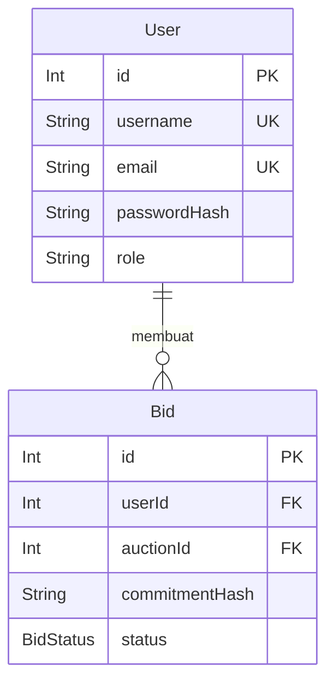

# Dokumen Teknis Modul 6 — PostgreSQL dan Prisma ORM

Nama/NIM : Rizqy Hergiansyah / [NIM]  
Repositori : https://github.com/hergiansyah24/project-aura-secrete-lelang-parfum

## 1. Rancangan Data

### Diagram Dua Entitas, Relasi, Kunci, dan Constraint Unik

Pada aplikasi Riggisa Parfume Secrète, rancangan data menggunakan dua entitas utama, yaitu User dan Bid. Kedua entitas memiliki hubungan One-to-Many (1:N), yaitu satu pengguna dapat memiliki banyak data penawaran, sedangkan satu data penawaran hanya dimiliki oleh satu pengguna.

Diagram relasi kedua entitas:

Keterangan:
- PK (Primary Key): Kunci utama untuk mengidentifikasi setiap data secara unik.
- FK (Foreign Key): Kunci asing yang menghubungkan tabel dengan tabel lain.
- UK (Unique Key): Constraint yang memastikan nilai tidak boleh memiliki duplikasi.

Kunci dan constraint yang digunakan:

| Entitas | Kolom | Jenis |
|---|---|---|
| User | id | Primary Key |
| User | username | Unique |
| User | email | Unique |
| Bid | id | Primary Key |
| Bid | userId | Foreign Key |
| Bid | auctionId | Foreign Key |
| Bid | auctionId, userId | Composite Unique |

Constraint unik gabungan `@@unique([auctionId, userId])` digunakan untuk mencegah seorang pengguna membuat lebih dari satu penawaran pada lelang yang sama. Dengan aturan ini, pengguna tetap dapat mengikuti beberapa lelang berbeda, tetapi hanya memiliki satu data bid pada setiap lelang.

### Alasan Pemilihan Aturan onDelete

Pada rancangan database digunakan beberapa aturan penghapusan berdasarkan kebutuhan relasi:

1. **Cascade pada User dan Bid:** Ketika data pengguna dihapus, data bid yang dimiliki pengguna tersebut ikut dihapus agar tidak terdapat data penawaran tanpa pemilik.
2. **Cascade pada Auction dan Bid:** Ketika data lelang dihapus, seluruh bid yang berhubungan dengan lelang tersebut ikut dihapus karena bid merupakan bagian dari data lelang.
3. **SetNull pada Auction dan User sebagai pemenang:** Jika pengguna yang menjadi pemenang dihapus, data lelang tetap dipertahankan dan kolom `winnerId` menjadi NULL.
4. **SetNull pada User dan AuditLog:** Jika pengguna dihapus, catatan audit tetap dipertahankan, sedangkan kolom `userId` menjadi NULL untuk menjaga riwayat aktivitas sistem.

Pemilihan aturan tersebut bertujuan menjaga konsistensi relasi antar tabel serta menghindari foreign key yang mengarah pada data yang sudah tidak tersedia.