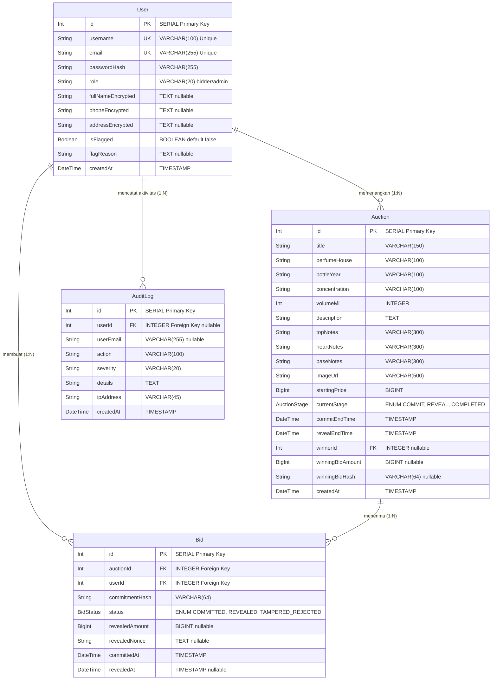
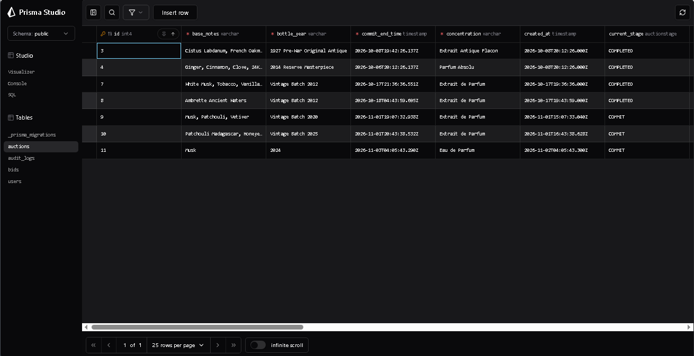
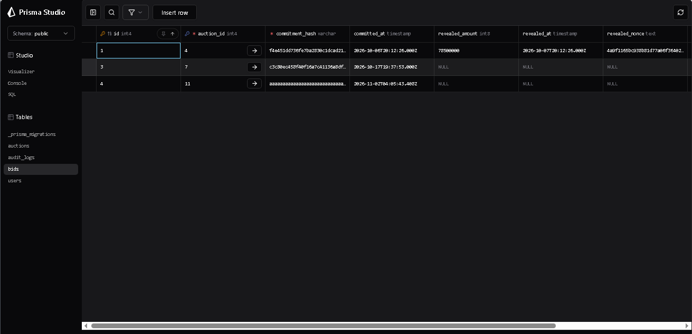
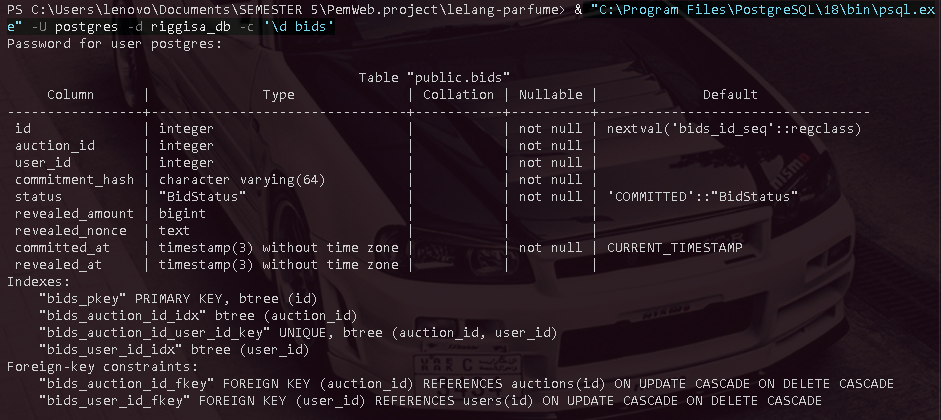
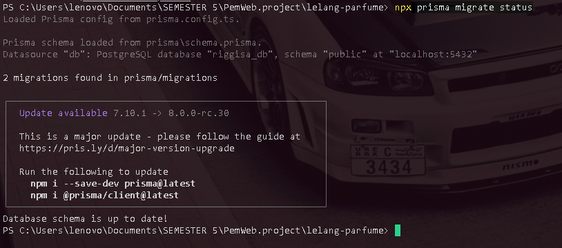
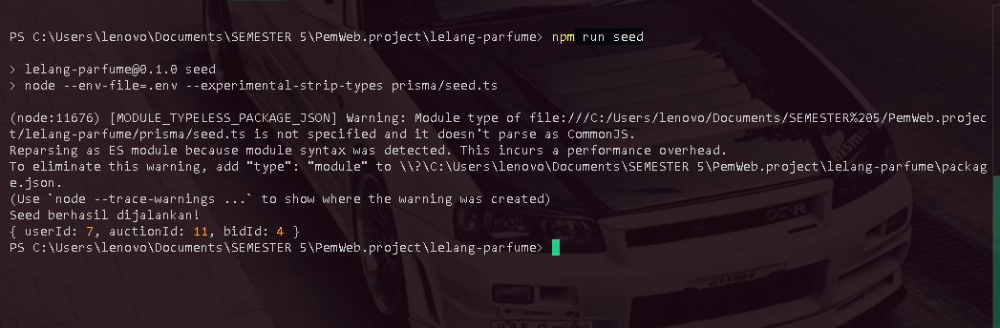
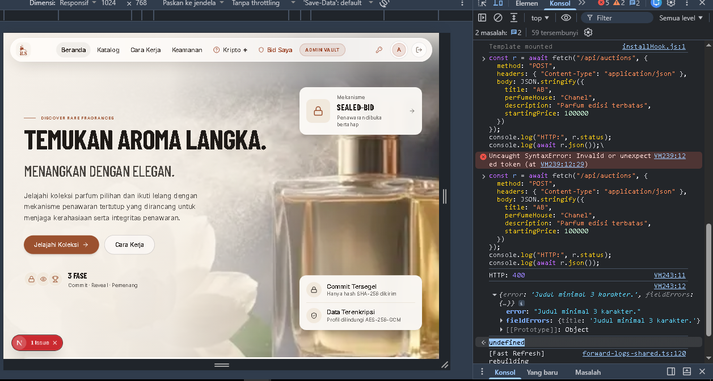
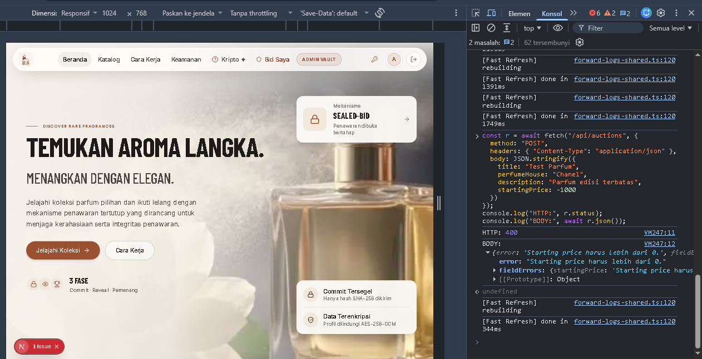
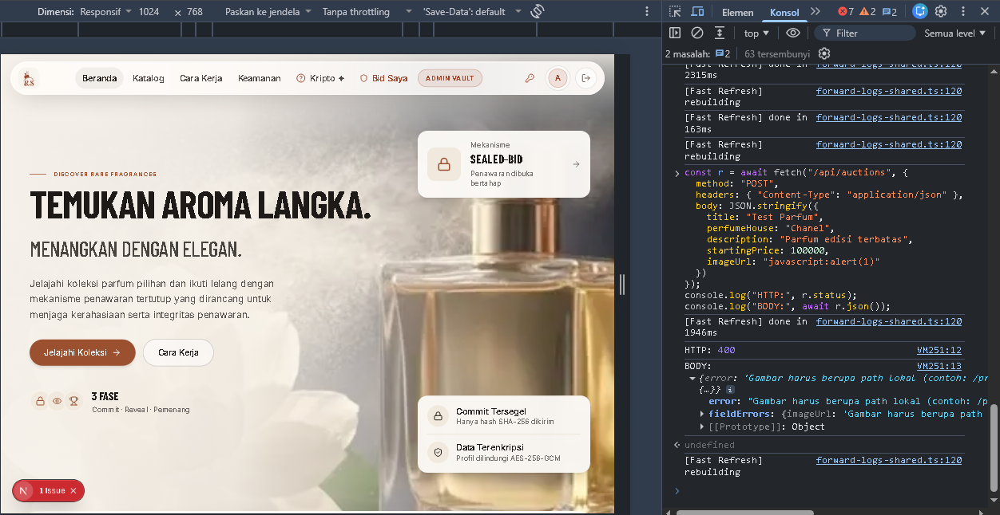
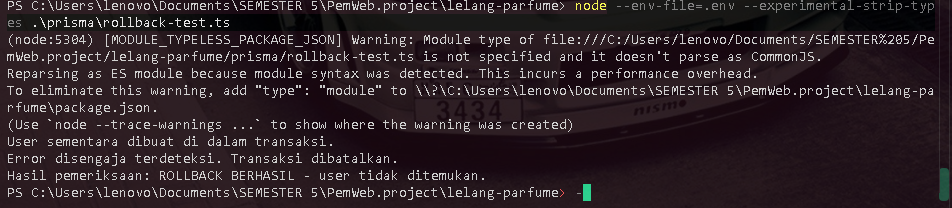

# Dokumen Teknis Modul 6 — PostgreSQL dan Prisma ORM

**Nama / NIM** : Rizqy Hergiansyah / 105224010
**Program Studi** : S1 Ilmu Komputer
**Mata Kuliah** : Praktikum Pengembangan Aplikasi Web (052356)
**Repositori** : [https://github.com/hergiansyah24/project-aura-secrete-lelang-parfum](https://github.com/hergiansyah24/project-aura-secrete-lelang-parfum)
**Versi Produk** : v0.2

---

## 1. Rancangan Data

### 1.1 Diagram Entitas, Relasi, Kunci, dan Constraint Unik

Pada aplikasi **Riggisa Parfume Secrète**, basis data relasional dikembangkan menggunakan PostgreSQL 18 yang dikelola melalui Prisma ORM 7. Entitas utama yang dihubungkan dalam relasi satu-ke-banyak (1:N) adalah entitas pengguna (**User**), lelang parfum (**Auction**), dan penawaran (**Bid**). Satu lelang parfum dapat menerima banyak penawaran dari berbagai pengguna, dan satu pengguna dapat mengajukan penawaran pada berbagai lelang.

Diagram relasi entitas (ERD) digambarkan sebagai berikut:



#### Rincian Kunci dan Constraint Database

| Entitas | Kolom | Jenis Constraint | Keterangan |
|---|---|---|---|
| **User** | `id` | Primary Key (`@id`) | Identifikasi unik setiap baris pengguna dengan auto-increment SERIAL |
| **User** | `username` | Unique (`@unique`) | Mencegah pendaftaran nama pengguna yang sama |
| **User** | `email` | Unique (`@unique`) | Menjamin satu akun hanya terdaftar dengan satu alamat surel unik |
| **Auction** | `id` | Primary Key (`@id`) | Identifikasi unik setiap objek lelang parfum |
| **Auction** | `winnerId` | Foreign Key (`@relation`) | Merujuk ke `User.id` pemenang lelang |
| **Bid** | `id` | Primary Key (`@id`) | Identifikasi unik baris data penawaran |
| **Bid** | `auctionId` | Foreign Key (`@relation`) | Merujuk ke `Auction.id` lelang yang diikuti |
| **Bid** | `userId` | Foreign Key (`@relation`) | Merujuk ke `User.id` penawar |
| **Bid** | `[auctionId, userId]` | Composite Unique (`@@unique`) | **Constraint Unik Gabungan**: Memastikan seorang pengguna hanya dapat membuat 1 penawaran (komitmen tertutup) pada 1 lelang yang sama |
| **AuditLog** | `id` | Primary Key (`@id`) | Identifikasi unik riwayat audit log |
| **AuditLog** | `userId` | Foreign Key (`@relation`) | Merujuk ke `User.id` aktor yang memicu aktivitas |

Constraint unik gabungan `@@unique([auctionId, userId])` menjadi pengaman di level basis data (*database-level constraint*) untuk mencegah manipulasi pengajuan penawaran ganda oleh penawar yang sama pada fase sealed-bid (`COMMIT`).

**Catatan Penanganan Constraint dan Error Prisma:**

Pengujian P2002 dilakukan secara langsung melalui Prisma Client pada skenario TC-10. Pengujian mencoba membuat dua data Bid dengan kombinasi `auctionId` dan `userId` yang sama. Database menolak data kedua karena melanggar composite unique constraint dan Prisma menghasilkan kode error P2002.

Pada endpoint aplikasi, proses commit menggunakan metode `upsert` sehingga data dengan pasangan kunci unik yang sama ditangani melalui mekanisme pembaruan data. Sementara itu, beberapa endpoint melakukan pemeriksaan keberadaan record terlebih dahulu dan mengembalikan HTTP 404 apabila data tidak ditemukan. Oleh karena itu, kode P2025 tidak diklaim sebagai respons yang selalu muncul pada endpoint tersebut.

---

### 1.2 Alasan Pemilihan Aturan `onDelete`

Dalam basis data PostgreSQL, integritas referensial diatur secara sadar menggunakan tindakan penghapusan foreign key (`onDelete`):

1. **`Cascade` pada Relasi `Auction` $\rightarrow$ `Bid`:**
   Ketika entitas lelang parfum dihapus dari database, seluruh data komitmen dan penawaran (`Bid`) yang terikat pada lelang tersebut ikut terhapus. Hal ini karena penawaran lelang bersifat dependen (*child record*) dan tidak memiliki arti jika objek lelang parfum yang ditawar sudah ditiadakan dari sistem.
2. **`Cascade` pada Relasi `User` $\rightarrow$ `Bid`:**
   Jika data akun pengguna penguji dihapus dari sistem, seluruh riwayat penawaran yang bersangkutan ikut dibersihkan untuk mencegah keberadaan data komitmen yatim (*orphan records*) tanpa pemilik penawar yang jelas.
3. **`SetNull` pada Relasi `Auction` $\rightarrow$ `User` sebagai Pemenang (`winnerId`):**
   Apabila seorang akun pengguna yang memenangkan lelang dihapus, data lelang parfum tersebut tetap dipertahankan untuk kebutuhan arsip lelang, dan kolom `winnerId` otomatis dialihkan menjadi `NULL`.
4. **`SetNull` pada Relasi `User` → `AuditLog` (`userId`):**
   Jika akun pengguna dihapus, data AuditLog tetap dipertahankan sebagai riwayat aktivitas sistem. Kolom `userId` akan diubah menjadi `NULL` sehingga data audit tidak ikut terhapus akibat penghapusan akun. Kolom `userEmail` dapat digunakan untuk menyimpan informasi email historis apabila nilainya telah dicatat ketika log dibuat.

---

## 2. Skema dan Migrasi

### 2.1 Isi Berkas `prisma/schema.prisma`

Berkas skema Prisma ORM 7 dikonfigurasi dengan provider `prisma-client` dan penentuan direktori luaran (*output path*) wajib ke `../generated/prisma`:

```prisma
generator client {
  provider = "prisma-client"
  output   = "../generated/prisma"
}

datasource db {
  provider = "postgresql"
}

enum AuctionStage {
  COMMIT
  REVEAL
  COMPLETED
}

enum BidStatus {
  COMMITTED
  REVEALED
  TAMPERED_REJECTED
}

model User {
  id                  Int        @id @default(autoincrement())
  username            String     @unique @db.VarChar(100)
  email               String     @unique @db.VarChar(255)
  passwordHash        String     @map("password_hash") @db.VarChar(255)
  role                String     @default("bidder") @db.VarChar(20)
  fullNameEncrypted   String?    @map("full_name_encrypted") @db.Text
  phoneEncrypted      String?    @map("phone_encrypted") @db.Text
  addressEncrypted    String?    @map("address_encrypted") @db.Text
  isFlagged           Boolean    @default(false) @map("is_flagged")
  flagReason          String?    @map("flag_reason") @db.Text
  createdAt           DateTime   @default(now()) @map("created_at")

  bids                Bid[]
  wonAuctions         Auction[]  @relation("AuctionWinner")
  auditLogs           AuditLog[]

  @@map("users")
}

model Auction {
  id                Int          @id @default(autoincrement())
  title             String       @db.VarChar(150)
  perfumeHouse      String       @map("perfume_house") @db.VarChar(100)
  bottleYear        String       @map("bottle_year") @db.VarChar(100)
  concentration     String       @db.VarChar(100)
  volumeMl          Int          @map("volume_ml")
  description       String       @db.Text
  topNotes          String       @map("top_notes") @db.VarChar(300)
  heartNotes        String       @map("heart_notes") @db.VarChar(300)
  baseNotes         String       @map("base_notes") @db.VarChar(300)
  imageUrl          String       @map("image_url") @db.VarChar(500)
  startingPrice     BigInt       @map("starting_price")
  currentStage      AuctionStage @default(COMMIT) @map("current_stage")
  commitEndTime     DateTime     @map("commit_end_time")
  revealEndTime     DateTime     @map("reveal_end_time")
  winnerId          Int?         @map("winner_id")
  winningBidAmount  BigInt?      @map("winning_bid_amount")
  winningBidHash    String?      @map("winning_bid_hash") @db.VarChar(64)
  createdAt         DateTime     @default(now()) @map("created_at")

  bids              Bid[]
  winner            User?        @relation("AuctionWinner", fields: [winnerId], references: [id], onDelete: SetNull)

  @@map("auctions")
}

model Bid {
  id              Int       @id @default(autoincrement())
  auctionId       Int       @map("auction_id")
  userId          Int       @map("user_id")
  commitmentHash  String    @map("commitment_hash") @db.VarChar(64)
  status          BidStatus @default(COMMITTED)
  revealedAmount  BigInt?   @map("revealed_amount")
  revealedNonce   String?   @map("revealed_nonce") @db.Text
  committedAt     DateTime  @default(now()) @map("committed_at")
  revealedAt      DateTime? @map("revealed_at")

  auction         Auction   @relation(fields: [auctionId], references: [id], onDelete: Cascade)
  user            User      @relation(fields: [userId], references: [id], onDelete: Cascade)

  @@unique([auctionId, userId])
  @@index([auctionId])
  @@index([userId])
  @@map("bids")
}

model AuditLog {
  id          Int       @id @default(autoincrement())
  userId      Int?      @map("user_id")
  userEmail   String?   @map("user_email") @db.VarChar(255)
  action      String    @db.VarChar(100)
  severity    String    @default("INFO") @db.VarChar(20)
  details     String    @db.Text
  ipAddress   String?   @default("127.0.0.1") @map("ip_address") @db.VarChar(45)
  createdAt   DateTime  @default(now()) @map("created_at")

  user        User?     @relation(fields: [userId], references: [id], onDelete: SetNull)

  @@index([createdAt])
  @@map("audit_logs")
}
```

---

### 2.2 Daftar Folder `prisma/migrations` dan Potongan `migration.sql`

Riwayat migrasi skema tersimpan pada folder `prisma/migrations/`:
- `prisma/migrations/20261031173004_init/migration.sql`
- `prisma/migrations/20261031195854_add_tampered_rejected_status/migration.sql`

Potongan berkas SQL hasil migrasi pertama (`20261031173004_init/migration.sql`):

```sql
-- CreateEnum
CREATE TYPE "AuctionStage" AS ENUM ('COMMIT', 'REVEAL', 'COMPLETED');

-- CreateEnum
CREATE TYPE "BidStatus" AS ENUM ('COMMITTED', 'REVEALED');

-- CreateTable users
CREATE TABLE "users" (
    "id" SERIAL NOT NULL,
    "username" VARCHAR(100) NOT NULL,
    "email" VARCHAR(255) NOT NULL,
    "password_hash" VARCHAR(255) NOT NULL,
    "role" VARCHAR(20) NOT NULL DEFAULT 'bidder',
    "created_at" TIMESTAMP(3) NOT NULL DEFAULT CURRENT_TIMESTAMP,
    CONSTRAINT "users_pkey" PRIMARY KEY ("id")
);

-- CreateTable auctions
CREATE TABLE "auctions" (
    "id" SERIAL NOT NULL,
    "title" VARCHAR(150) NOT NULL,
    "perfume_house" VARCHAR(100) NOT NULL,
    "starting_price" BIGINT NOT NULL,
    "current_stage" "AuctionStage" NOT NULL DEFAULT 'COMMIT',
    "winner_id" INTEGER,
    "created_at" TIMESTAMP(3) NOT NULL DEFAULT CURRENT_TIMESTAMP,
    CONSTRAINT "auctions_pkey" PRIMARY KEY ("id")
);

-- CreateTable bids
CREATE TABLE "bids" (
    "id" SERIAL NOT NULL,
    "auction_id" INTEGER NOT NULL,
    "user_id" INTEGER NOT NULL,
    "commitment_hash" VARCHAR(64) NOT NULL,
    "status" "BidStatus" NOT NULL DEFAULT 'COMMITTED',
    "revealed_amount" BIGINT,
    "committed_at" TIMESTAMP(3) NOT NULL DEFAULT CURRENT_TIMESTAMP,
    CONSTRAINT "bids_pkey" PRIMARY KEY ("id")
);

-- CreateIndex
CREATE UNIQUE INDEX "users_username_key" ON "users"("username");
CREATE UNIQUE INDEX "users_email_key" ON "users"("email");
CREATE INDEX "bids_auction_id_idx" ON "bids"("auction_id");
CREATE INDEX "bids_user_id_idx" ON "bids"("user_id");
CREATE UNIQUE INDEX "bids_auction_id_user_id_key" ON "bids"("auction_id", "user_id");

-- AddForeignKey
ALTER TABLE "auctions" ADD CONSTRAINT "auctions_winner_id_fkey"
  FOREIGN KEY ("winner_id") REFERENCES "users"("id") ON DELETE SET NULL ON UPDATE CASCADE;

ALTER TABLE "bids" ADD CONSTRAINT "bids_auction_id_fkey"
  FOREIGN KEY ("auction_id") REFERENCES "auctions"("id") ON DELETE CASCADE ON UPDATE CASCADE;

ALTER TABLE "bids" ADD CONSTRAINT "bids_user_id_fkey"
  FOREIGN KEY ("user_id") REFERENCES "users"("id") ON DELETE CASCADE ON UPDATE CASCADE;
```

---

### 2.3 Tangkapan Layar `\d` Hasil psql (Indeks dan Foreign Key)

Pemeriksaan struktur tabel di basis data PostgreSQL membuktikan bahwa seluruh indeks unik, primary key, dan foreign key telah aktif diterapkan di engine database:


*Gambar 2.1: Bukti struktur tabel auctions dan foreign key.*


*Gambar 2.2: Bukti struktur tabel bids, indeks unik gabungan bids_auction_id_user_id_key, dan foreign key.*


*Gambar 2.3: Bukti pemeriksaan struktur tabel bids melalui perintah psql, termasuk primary key, indeks, dan foreign key.*


*Gambar 2.3: Bukti status migrasi Prisma (2 migrations applied, database schema up to date).*

> [!NOTE]
> *(Panduan Bukti Tambahan)*: Jika asisten laboratorium meminta tangkapan layar spesifik CLI terminal `psql -c '\d "bids"'` dan `psql -c '\d "auctions"'`, jalankan perintah `psql -U praktikum -d riggisa_db -c '\d "bids"'` pada terminal dan simpan tangkapan layarnya ke folder bukti.

---

## 3. Seed dan Prisma Client

### 3.1 Keluaran `npm run seed` yang Dijalankan Dua Kali

Skrip seeding pada `prisma/seed.ts` disusun menggunakan metode `.upsert()` pada model User dan Bid serta pengecekan record pada Auction. Hal ini menjamin sifat **idempotensi** (seed dapat dijalankan berulang kali tanpa menghasilkan data duplikat atau memicu galat `P2002`).

Hasil eksekusi seed dua kali berturut-turut pada terminal:

Eksekusi Pertama:
Seed berhasil dijalankan!
{ userId: 7, auctionId: 33, bidId: 21 }

Eksekusi Kedua:
Seed berhasil dijalankan!
{ userId: 7, auctionId: 33, bidId: 21 }

```bash
# Eksekusi Pertama:
$ npm run seed
> lelang-parfume@0.1.0 seed
> node --env-file=.env --experimental-strip-types prisma/seed.ts

Seed berhasil dijalankan!
{ userId: 7, auctionId: 33, bidId: 21 }

# Eksekusi Kedua (Membuktikan Idempotensi):
$ npm run seed
> lelang-parfume@0.1.0 seed
> node --env-file=.env --experimental-strip-types prisma/seed.ts

Seed berhasil dijalankan!
{ userId: 7, auctionId: 33, bidId: 21 }
```


*Gambar 3.1: Bukti keberhasilan eksekusi seed data.*


*Gambar 3.2: Bukti eksekusi seed dua kali dengan ID User, Auction, dan Bid yang tetap sama.*

Jumlah data pengguna, lelang, dan penawaran tetap konsisten (tidak digandakan) pada eksekusi kedua karena klausul `where` pada `upsert` mendeteksi bahwa data dengan kunci unik tersebut telah ada sebelumnya.

---

### 3.2 Alasan Seed Tidak Mengimpor `lib/prisma.ts`

Pada arsitektur Next.js (App Router), berkas [`lib/prisma.ts`](../../../lib/prisma.ts) memuat direktif perlindungan impor `import "server-only";` untuk memastikan instans Prisma Client tidak pernah bocor atau terimpor secara tidak sengaja ke lingkungan Client Component (browser).

Namun, skrip `prisma/seed.ts` dijalankan di luar runtime server Next.js, yaitu dieksekusi langsung melalui terminal/CLI Node.js (`tsx` atau `node --experimental-strip-types`). Jika `seed.ts` mengimpor `lib/prisma.ts`, Node.js akan melempar kesalahan kompilasi:
```text
RuntimeError: This module cannot be imported from a Client Component or outside Next.js runtime (server-only).
```
Oleh karena itu, sesuai dengan petunjuk resmi Modul 6, berkas `prisma/seed.ts` menginisialisasi instans `PrismaClient` mandiri menggunakan adapter `@prisma/adapter-pg` dan membaca variabel lingkungan secara langsung melalui `--env-file=.env` atau `dotenv/config`.

---

## 4. Operasi CRUD

### 4.1 Tabel Operasi CRUD dan Penanganan Galat Prisma

Aplikasi mengimplementasikan operasi CRUD menyeluruh untuk entitas `Auction` dan `Bid` melalui Server Action dan Route Handlers yang memvalidasi masukan serta menangani galat kode Prisma:

| Entitas | Operasi | Aksi / Endpoint / Halaman | Metode Prisma Client | Galat Prisma / Zod yang Ditangani | Pesan ke Pengguna / Respons Sistem |
|---|---|---|---|---|---|
| **Auction** | Create | `POST /api/auctions` | `prisma.auction.create` | Validasi Zod `createAuctionSchema`, `P2002` (Constraint unik) | HTTP 200: "Lelang parfum langka berhasil ditambahkan." / HTTP 400 dengan pesan field error spesifik |
| **Auction** | Read | `GET /api/auctions` | `prisma.auction.findMany` | Filter kondisi `where`, pencarian insensitif, relasi count | Menampilkan katalog lelang parfum beserta informasi penawar |
| **Auction** | Read Detail | `GET /api/auctions/[id]` & `/auctions/[id]` | `prisma.auction.findUnique` | Record bernilai `null` | Mengembalikan HTTP 404 / halaman `not-found.tsx` jika lelang tidak ditemukan |
| **Auction** | Update | `PUT /api/auctions/[id]` | `prisma.auction.update` | `P2025` (Record not found), Zod validation | "Detail lelang berhasil diperbarui di PostgreSQL" atau HTTP 404 jika ID salah |
| **Auction** | Delete | `DELETE /api/auctions/[id]` | `prisma.auction.delete` | `P2025` (Record not found), referential constraint | "Lelang berhasil dihapus." beserta pembersihan relasi anak |
| **Bid** | Create (Commit) | `POST /api/bids/commit` | `prisma.bid.upsert` | `P2002` (Unique constraint `[auctionId, userId]`), Zod hash regex | "Komitmen penawaran terenkripsi SHA-256 berhasil dicatat di server." |
| **Bid** | Read | `GET /api/admin/bids` & `/my-bids` | `prisma.bid.findMany` | Include relasi `user` dan `auction` | Membaca daftar seluruh penawaran untuk audit admin dan ledger penawar |
| **Bid** | Update (Reveal) | `POST /api/bids/reveal` | `prisma.bid.update` | `P2025` (Penawaran tidak ditemukan), Hash mismatch | Mengubah status bid menjadi `REVEALED` dan menyimpan nominal penawaran terbuka |
| **Bid** | Delete | `DELETE /api/admin/bids` | `tx.bid.delete` (via `prisma.$transaction`) | Rule check lelang belum selesai (HTTP 409), `P2025` | "Penawaran hanya dapat dihapus setelah lelang selesai." untuk menjaga integritas kompetisi |

---

### 4.2 Bukti Tangkapan Layar CRUD dan Validasi Formulir

Berikut adalah dokumentasi tangkapan layar pengoperasian CRUD pada antarmuka aplikasi:

#### 1. Operasi Create Auction (Penambahan Lelang)
.png)
*Gambar 4.1: Notifikasi keberhasilan penambahan lelang baru ke PostgreSQL.*

#### 2. Operasi Read Auction (Katalog dan Manajemen Lelang)

*Gambar 4.2: Tampilan daftar data lelang parfum pada dashboard administrator.*

#### 3. Operasi Update Auction (Pembaruan Informasi)

*Gambar 4.3: Bukti pembaruan nama parfum dan harga awal lelang di basis data.*

#### 4. Operasi Delete Auction (Penghapusan Lelang)

*Gambar 4.4a: Kondisi daftar lelang sebelum penghapusan dilakukan.*


*Gambar 4.4b: Kondisi daftar lelang setelah data target berhasil dihapus.*

#### 5. Validasi Masukan Sisi Server (Zod & Error Handling)

*Gambar 4.5: Penolakan input judul kurang dari 3 karakter oleh server.*


*Gambar 4.6: Penolakan input harga awal negatif oleh server.*


*Gambar 4.7: Penolakan format URL gambar dengan skema berbahaya.*

---

## 5. Transaksi dan Rollback

### 5.1 Implementasi Transaksi Atomik Prisma

Pada sistem lelang parfum, proses penghapusan penawaran dan pencatatan aktivitas audit harus dilakukan secara konsisten. Oleh karena itu, endpoint `DELETE /api/admin/bids` menggunakan transaksi interaktif `prisma.$transaction`. Dengan mekanisme ini, operasi penghapusan Bid dan pembuatan AuditLog dijalankan dalam satu transaksi sehingga apabila salah satu operasi gagal, seluruh transaksi dapat dibatalkan.

```typescript
// Implementasi pada app/api/admin/bids/route.ts
await prisma.$transaction(async (tx) => {
  // Perintah 1: Hapus penawaran
  await tx.bid.delete({
    where: { id: bidId },
  });

  // Perintah 2: Catat audit log penghapusan (saling bergantung)
  await tx.auditLog.create({
    data: {
      userId: currentUser.id,
      userEmail: currentUser.email,
      action: "BID_DELETE",
      severity: "WARN",
      details: JSON.stringify({
        bidId,
        auctionId: bid.auctionId,
        auctionTitle: bid.auction.title,
        bidderUsername: bid.user.username,
        deletedStatus: bid.status,
      }),
      ipAddress: "127.0.0.1",
    },
  });
});
```

---

### 5.2 Galat Integritas Relasional dan Mekanisme Rollback

1. **Integritas Foreign Key:**

   Relasi antara Auction dan Bid serta User dan Bid menggunakan aturan `ON DELETE CASCADE`. Dengan aturan tersebut, penghapusan entitas induk akan diikuti penghapusan data Bid yang bergantung padanya. Sementara itu, relasi Auction dengan User sebagai pemenang dan User dengan AuditLog menggunakan `ON DELETE SET NULL` untuk mempertahankan data terkait ketika akun pengguna dihapus.

2. **Pembuktian Rollback Melalui Pengujian Prisma:**

   Mekanisme rollback diuji menggunakan transaksi interaktif `prisma.$transaction`. Pengujian membuat satu User sementara di dalam transaksi, kemudian memunculkan exception secara sengaja sebelum transaksi selesai.

   - **Kondisi Sebelum:** Username `rollback_test_modul6` belum ditemukan dalam tabel `users`.
   - **Eksekusi:** Prisma menjalankan operasi pembuatan User di dalam transaksi, kemudian menerima exception yang disengaja.
   - **Kondisi Sesudah:** Transaksi dibatalkan secara otomatis. Pemeriksaan ulang menggunakan `findUnique` menghasilkan `null`, yang membuktikan bahwa User sementara tidak tersimpan di database.

   Hasil tersebut membuktikan prinsip atomisitas transaksi (*all-or-nothing*) pada Prisma Client.



*Gambar 5.1: Bukti transaksi Prisma dibatalkan setelah exception disengaja dan data User sementara tidak tersimpan.*

---

## 6. Skenario Uji

Pengujian dilakukan mencakup 10 skenario wajib (8 skenario operasi CRUD dan 2 skenario integritas relasi) yang dieksekusi melalui suite pengujian otomatis `tests/database.test.ts`.

### 6.1 Tabel 10 Skenario Pengujian Database

| No | Kode Uji | Skenario Pengujian | Langkah Pengujian | Hasil yang Diharapkan | Hasil Aktual | Status |
|:---:|:---:|---|---|---|---|:---:|
| 1 | **TC-01** | Create Auction | Menjalankan pembuatan lelang parfum baru via Prisma Client | Record tersimpan di tabel `auctions`, `id > 0`, harga awal sesuai | Record tersimpan dengan id valid dan harga 100.000 | **LULUS** |
| 2 | **TC-02** | Read Auction | Mencari data lelang berdasarkan `id` lelang yang valid | Objek lelang berhasil ditemukan dengan atribut judul dan deskripsi lengkap | Data lelang berhasil dibaca dari tabel `auctions` | **LULUS** |
| 3 | **TC-03** | Update Auction | Memperbarui judul lelang menjadi `"Test Auction Updated"` | Judul lelang terupdate secara persisten pada basis data | Judul lelang berhasil berubah menjadi `"Test Auction Updated"` | **LULUS** |
| 4 | **TC-04** | Delete Auction | Menghapus record lelang pengujian menggunakan `id` | Record lelang terhapus (`findUnique` menghasilkan `null`) | Record lelang terhapus dari tabel dan bernilai `null` | **LULUS** |
| 5 | **TC-05** | Create Bid | Menambahkan penawaran tertutup dengan komitmen hash 64-karakter | Record tersimpan di tabel `bids` dengan status `COMMITTED` | Bid berhasil dibuat dengan status awal `COMMITTED` | **LULUS** |
| 6 | **TC-06** | Read Bid | Membaca data penawaran yang baru dibuat berdasarkan ID | Data penawaran terbaca dengan `auctionId` dan status yang cocok | Data penawaran terbaca dengan id dan auctionId sesuai | **LULUS** |
| 7 | **TC-07** | Update Bid | Memperbarui penawaran menjadi fase terbuka (`REVEALED`) | Status berubah menjadi `REVEALED` dan nilai `revealedAmount` terisi | Status berubah menjadi `REVEALED` dan nominal tersimpan | **LULUS** |
| 8 | **TC-08** | Delete Bid | Menghapus data penawaran dari tabel `bids` | Record penawaran terhapus dari basis data (`null`) | Record bid terhapus dan pencarian menghasilkan `null` | **LULUS** |
| 9 | **TC-09** | Relasi Data | Mengambil penawaran dengan klausa `include: { auction: true, user: true }` | Objek penawaran terhubung valid ke entitas induk `Auction` dan `User` | Eager load berhasil memuat relasi Auction dan User yang cocok | **LULUS** |
| 10 | **TC-10** | Constraint Unik | Mencoba menambahkan 2 penawaran untuk pasangan `(auctionId, userId)` yang sama | Database menolak duplikasi dan melempar galat Prisma `P2002` | Permintaan ditolak dengan error `P2002: Unique constraint failed` | **LULUS** |

---

### 6.2 Persentase Kelulusan Pengujian

$$\text{Persentase Kelulusan} = \frac{\text{Jumlah Skenario LULUS}}{\text{Total Skenario}} \times 100\% = \frac{10}{10} \times 100\% = \mathbf{100\%}$$

Hasil pengujian memenuhi ambang batas kelulusan praktikum ($\ge 90\%$).


*Gambar 6.1: Bukti keluaran tes otomatis Node.js test runner dengan 10 skenario pengujian 100% lulus.*

---

## 7. Kendala dan Penyelesaian

Selama pengerjaan Modul 6 dan integrasi PostgreSQL dengan Prisma ORM 7, ditemukan beberapa kendala teknis serta solusi penyelesaiannya:

1. **Wajib Driver Adapter pada Prisma ORM 7:**
   *Kendala:* Prisma 7 tidak lagi menyertakan driver native secara default dan mewajibkan penggunaan driver adapter eksternal.
   *Penyelesaian:* Menginstal `@prisma/adapter-pg` dan paket `pg`, kemudian mengonfigurasi instans adapter di `lib/prisma.ts` dan `prisma/seed.ts` menggunakan parameter `connectionString`.
2. **Alur Generate dan Seeding Terpisah:**
   *Kendala:* Perintah `npx prisma migrate dev` pada Prisma 7 tidak lagi menjalankan `generate` maupun `seed` secara otomatis, sehingga tipe data klien sempat tidak terbarui dan database kosong.
   *Penyelesaian:* Menjalankan perintah secara berurutan dan eksplisit: `npx prisma migrate dev`, disusul `npx prisma generate`, lalu menjalankan seeding via `npm run seed`.
3. **Pembatasan Runtime `server-only` pada Seeding:**
   *Kendala:* Skrip `prisma/seed.ts` gagal dijalankan karena mencoba mengimpor client dari `lib/prisma.ts` yang memuat baris `import "server-only";`.
   *Penyelesaian:* Mengisolasi skrip seed dengan membuat instans `PrismaClient` independen di dalam berkas `seed.ts`, sehingga skrip dapat dieksekusi secara mulus melalui runtime CLI Node.js di luar Next.js.
4. **Serialisasi Nilai `BigInt` pada Endpoint API:**
   *Kendala:* Kolom harga awal (`startingPrice`) dan penawaran (`revealedAmount`) menggunakan tipe data `BigInt` di PostgreSQL, yang menghasilkan error `TypeError: Do not know how to serialize a BigInt` saat dikirimkan via `NextResponse.json()`.
   *Penyelesaian:* Melakukan pemetaan konversi tipe data eksplisit menggunakan `Number(value)` sebelum objek respons dikirimkan ke client.

---

## 8. Catatan Pemanfaatan AI

Sesuai dengan ketentuan umum Modul 6 mengenai transparansi penggunaan kecerdasan artifisial, berikut adalah catatan pemanfaatannya:

- **Alat Bantu AI:** Antigravity AI Coding Assistant (Gemini 3.8 Flash).
- **Perintah Utama (Prompt):**
  - "Baca berkas modul 6 praktikum PAW 2026.pdf dan sesuaikan laporan teknis modul-06.md sesuai struktur serta rubrik penilaiannya."
  - "Verifikasi keterkaitan skema database, foreign key, composite constraint, dan file pengujian 10 skenario yang sudah ada di repositori lelang-parfume."
  - "Identifikasi berkas bukti yang sudah tersedia di folder docs/Tugas_2/bukti dan tentukan apa saja bukti yang masih perlu dilengkapi."
- **Bagian yang Dibantu AI:**
  - Penataan dan penyusunan struktur markdown laporan teknis sesuai format Bab 1 hingga Bab 8 pada modul praktikum.
  - Pembuatan diagram relasi ERD menggunakan format Mermaid.
  - Pengelompokan dan penjelasan kode galat Prisma yang relevan dengan implementasi dan pengujian, khususnya `P2002` pada pengujian constraint unik.
- **Cara Memverifikasi Hasil AI:**
  - Menguji keabsahan sintaksis skema Prisma dengan perintah `npx prisma validate`.
  - Memeriksa status migrasi database dengan `npx prisma migrate status`.
  - Menjalankan suite pengujian unit dan integrasi database secara langsung via perintah `node --env-file=.env --experimental-strip-types --test tests/database.test.ts`.
  - Memverifikasi secara visual gambar bukti yang tersedia di direktori `docs/Tugas_2/bukti/`.
