# Pengujian Kontrol Akses Berbasis Peran (RBAC)

## 1. Tujuan

Dokumen ini mencatat matriks akses dan hasil pengujian kontrol akses berbasis peran untuk Tugas 2 Keamanan Komputasi dan Siber pada aplikasi Riggisa Parfume Secrète.

Pengujian berfokus pada dua role aplikasi:

- `admin`: dapat menjalankan fitur administrasi sesuai otorisasi server-side.
- `bidder`: dapat menggunakan fitur penawaran yang memerlukan sesi, tetapi tidak dapat menjalankan fitur administrasi.

Hasil `PASS` di bawah hanya digunakan untuk skenario yang benar-benar telah diuji dan dikonfirmasi. Skenario lain tidak dinyatakan berhasil.

## 2. Matriks Akses Berdasarkan Peran

| Fitur / endpoint | Admin | Bidder | Keterangan |
|---|---|---|---|
| Melihat daftar lelang — `GET /api/auctions` | Boleh | Boleh | Endpoint publik. |
| Melihat detail lelang — `GET /api/auctions/:id` | Boleh | Boleh | Endpoint publik. |
| Membuat lelang — `POST /api/auctions` | Boleh | Tidak boleh | Memerlukan role `admin`. |
| Mengubah lelang — `PUT /api/auctions/:id` | Boleh | Tidak boleh | Memerlukan role `admin`. |
| Menghapus lelang — `DELETE /api/auctions/:id` | Boleh | Tidak boleh | Memerlukan role `admin`. |
| Finalisasi lelang — `POST /api/auctions/:id/finalize` | Boleh | Tidak boleh | Memerlukan role `admin`. |
| Commit bid — `POST /api/bids/commit` | Diizinkan dengan sesi* | Diizinkan dengan sesi | Memerlukan sesi valid dan dipengaruhi stage/status akun. |
| Reveal bid — `POST /api/bids/reveal` | Diizinkan dengan sesi* | Diizinkan dengan sesi | Memerlukan sesi valid dan dipengaruhi stage/status akun. |
| Melihat bid sendiri — `GET /api/bids/my-bids` | Boleh dengan sesi | Boleh dengan sesi | Data difilter berdasarkan ID pengguna sesi. |
| Melihat daftar pengguna — `GET /api/admin/users` | Boleh | Tidak boleh | Memerlukan role `admin`. |
| Flag/unflag pengguna — `POST /api/admin/users` | Boleh | Tidak boleh | Memerlukan role `admin`. |
| Melihat seluruh bid — `GET /api/admin/bids` | Boleh | Tidak boleh | Memerlukan role `admin`. |
| Menghapus bid — `DELETE /api/admin/bids` | Boleh dengan syarat | Tidak boleh | Memerlukan role `admin`; kondisi bid/auction tetap berlaku. |
| Melihat audit log — `GET /api/admin/audit-logs` | Boleh | Tidak boleh | Memerlukan role `admin`. |
| Upload gambar — `POST /api/admin/upload-image` | Boleh | Tidak boleh | Memerlukan role `admin`. |
| Reset data demo — `POST /api/admin/demo-reset` | Boleh | Tidak boleh | Memerlukan role `admin`; hanya untuk lingkungan uji yang sesuai. |
| Registrasi dan login | Boleh | Boleh | Registrasi publik membuat role `bidder`; login memerlukan kredensial valid. |

\* Pemeriksaan kode menunjukkan endpoint commit/reveal memerlukan sesi dan status akun, tetapi tidak memeriksa `role === "bidder"` secara eksplisit. Karena itu, matriks ini tidak menyatakan endpoint tersebut eksklusif untuk bidder.

## 3. Hasil Pengujian Aktual

Bagian ini memuat hasil pengujian yang telah dikonfirmasi `PASS`; pengujian yang belum dicatat atau belum memiliki bukti tetap tidak dinyatakan berhasil.

### AT-P11 — Login berhasil sebagai bidder

- **Request:** `POST /api/auth/login`
- **Status HTTP aktual:** `200`
- **Hasil:** `success: true`; role pada respons: `bidder`.
- **Status:** `PASS`

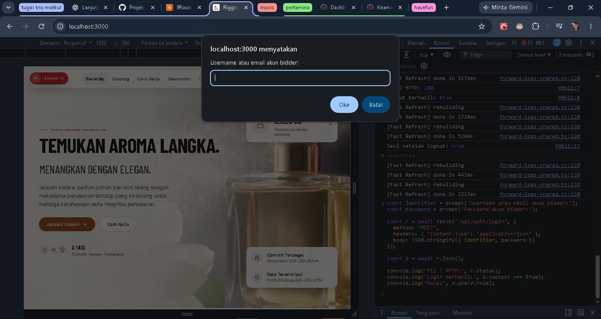

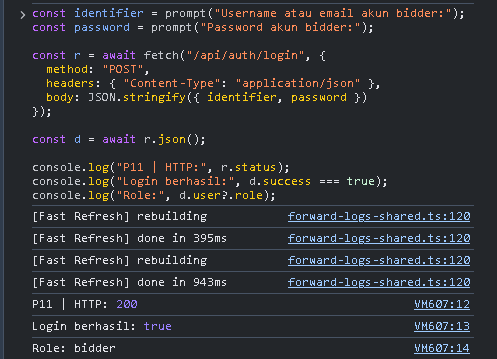

### AT-P12 — Logout berhasil sebagai bidder

- **Role/kondisi:** bidder dengan sesi login aktif
- **Request:** `POST /api/auth/logout`
- **Status HTTP aktual:** `200`
- **Hasil:** `success: true`; verifikasi lanjutan `GET /api/auth/me` menghasilkan `user === null`.
- **Status:** `PASS`
- **Bukti:** Belum tersedia. File `./bukti_tugas2/AT-P12_logout_bidder_berhasil.png` tidak ditemukan di `security/bukti_tugas2/` saat pemeriksaan.

### AT-P16 — Profil sesi tanpa autentikasi

- **Role/kondisi:** tanpa sesi
- **Request:** `GET /api/auth/me`
- **Status HTTP aktual:** `200`
- **Hasil:** `PASS` — respons `{"user":null}`; pengguna tanpa sesi tidak memiliki profil aktif.

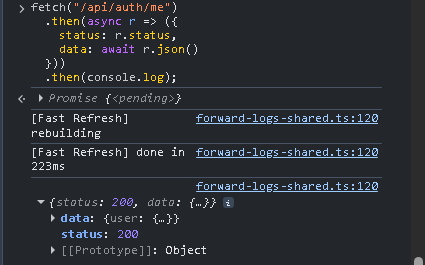

### AT-N02 — Bidder ditolak membuat lelang

- **Role/kondisi:** `bidder`
- **Request:** `POST /api/auctions`
- **Status HTTP aktual:** `403`
- **Hasil:** `PASS` — akses ditolak karena bukan admin.

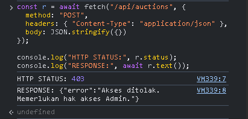

*Caption: Bukti respons penolakan ketika bidder mencoba membuat lelang.*

### AT-N03 — Bidder ditolak mengubah lelang

- **Role/kondisi:** `bidder`
- **Request:** `PUT /api/auctions/:id`
- **Status HTTP aktual:** `403`
- **Hasil:** `PASS` — akses ditolak karena bukan admin.

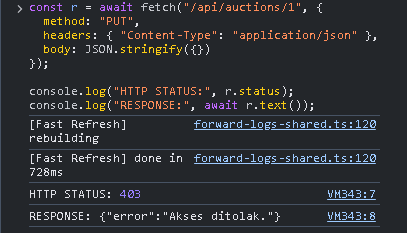

*Caption: Bukti respons penolakan ketika bidder mencoba mengubah lelang.*

### AT-N04 — Bidder ditolak menghapus lelang

- **Role/kondisi:** `bidder`
- **Request:** `DELETE /api/auctions/:id`
- **Status HTTP aktual:** `403`
- **Hasil:** `PASS` — akses ditolak karena bukan admin.

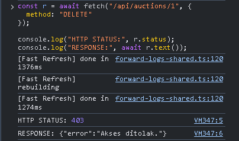

*Caption: Bukti respons penolakan ketika bidder mencoba menghapus lelang.*

### AT-N05 — Bidder ditolak melakukan finalisasi lelang

- **Role/kondisi:** `bidder`
- **Request:** `POST /api/auctions/:id/finalize`
- **Status HTTP aktual:** `403`
- **Hasil:** `PASS` — akses ditolak karena bukan admin.

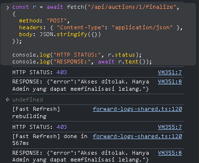

*Caption: Bukti respons penolakan ketika bidder mencoba memfinalisasi lelang.*

### AT-N06 — Bidder ditolak mengakses daftar pengguna

- **Role/kondisi:** `bidder`
- **Request:** `GET /api/admin/users`
- **Status HTTP aktual:** `403`
- **Hasil:** `PASS` — akses ditolak karena endpoint memerlukan admin.

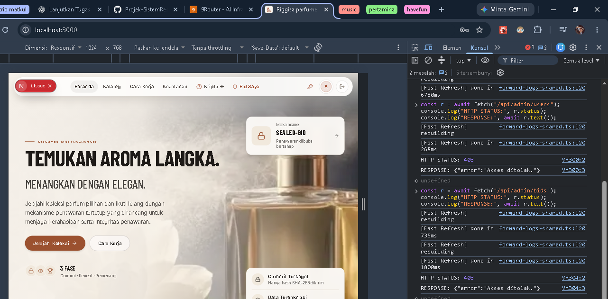

*Caption: Bukti respons penolakan akses bidder ke daftar pengguna administratif.*

### AT-N07 — Bidder ditolak melakukan flag/unflag

- **Role/kondisi:** `bidder`
- **Request:** `POST /api/admin/users`
- **Status HTTP aktual:** `403`
- **Hasil:** `PASS` — akses ditolak karena endpoint memerlukan admin.

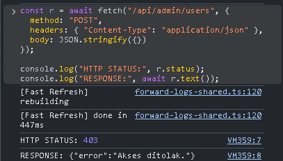

*Caption: Bukti respons penolakan ketika bidder mencoba melakukan flag/unflag pengguna.*

### AT-N08 — Bidder ditolak mengakses seluruh bid

- **Role/kondisi:** `bidder`
- **Request:** `GET /api/admin/bids`
- **Status HTTP aktual:** `403`
- **Hasil:** `PASS` — akses ditolak karena endpoint memerlukan admin.

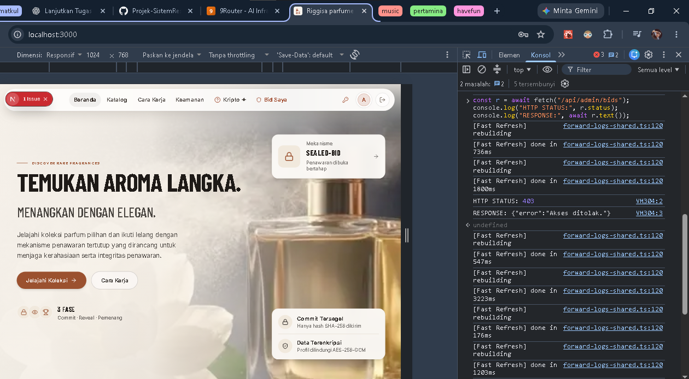

*Caption: Bukti respons penolakan akses bidder ke seluruh data bid administratif.*

### AT-N09 — Bidder ditolak menghapus bid

- **Role/kondisi:** `bidder`
- **Request:** `DELETE /api/admin/bids`
- **Status HTTP aktual:** `403`
- **Hasil:** `PASS` — akses ditolak karena endpoint memerlukan admin.

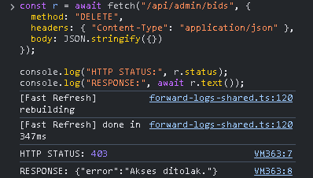

*Caption: Bukti respons penolakan ketika bidder mencoba menghapus bid.*

### AT-N10 — Bidder ditolak mengakses audit log

- **Role/kondisi:** `bidder`
- **Request:** `GET /api/admin/audit-logs`
- **Status HTTP aktual:** `403`
- **Hasil:** `PASS` — akses ditolak karena endpoint memerlukan admin.

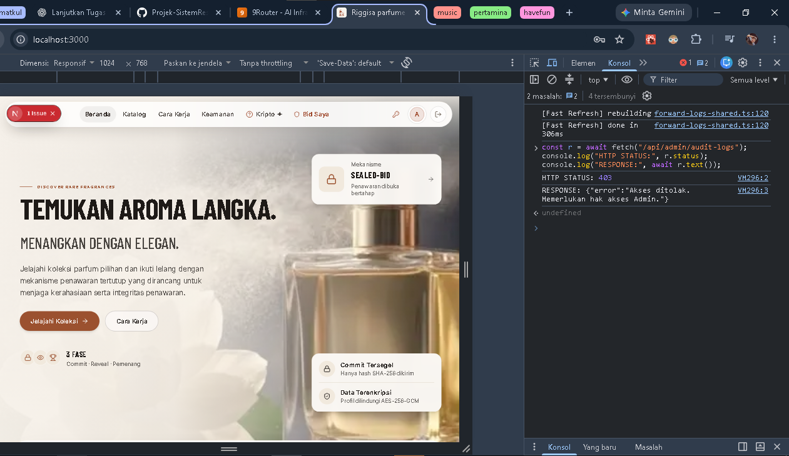

*Caption: Bukti respons penolakan akses bidder ke audit log administratif.*

### AT-N13 — Commit tanpa autentikasi

- **Role/kondisi:** tanpa sesi
- **Request:** `POST /api/bids/commit`
- **Status HTTP aktual:** `401`
- **Hasil:** `PASS` — request ditolak karena tidak memiliki sesi autentikasi.

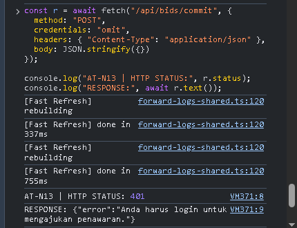

### AT-N14 — Reveal tanpa autentikasi

- **Role/kondisi:** tanpa sesi
- **Request:** `POST /api/bids/reveal`
- **Status HTTP aktual:** `401`
- **Hasil:** `PASS` — request ditolak karena tidak memiliki sesi autentikasi.

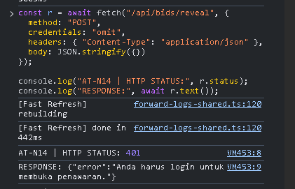

### AT-N15 — Riwayat bid tanpa autentikasi

- **Role/kondisi:** tanpa sesi
- **Request:** `GET /api/bids/my-bids`
- **Status HTTP aktual:** `401`
- **Hasil:** `PASS` — request ditolak karena endpoint memerlukan sesi.

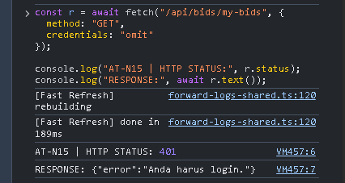

## 4. Poin 2 — Password Hashing

### Hasil Pemeriksaan Statis

- Registrasi menggunakan `hashPassword(password)` sebelum data pengguna disimpan (`app/api/auth/register/route.ts`).
- Implementasi `hashPassword` menggunakan `bcrypt.hash(password, 10)` (`lib/auth.ts`).
- Login memverifikasi password menggunakan `bcrypt.compare(password, hash)` melalui `verifyPassword` (`lib/auth.ts` dan `app/api/auth/login/route.ts`).
- Database menyimpan nilai pada field `passwordHash` yang dipetakan ke `password_hash`, bukan plaintext password (`prisma/schema.prisma`).
- Respons login hanya mengembalikan data profil yang diperlukan dan tidak mengekspos `passwordHash` (`app/api/auth/login/route.ts`).

### Hasil Pengujian Runtime bcrypt dengan Data Dummy

Pengujian dilakukan secara mandiri di memori menggunakan data dummy. Pengujian tidak mengakses database, API register/login, atau data pengguna nyata. Password dan nilai hash tidak ditampilkan.

```text
hashCreated: true
costFactor: 10
correctPassword: true
wrongPassword: false
```


*Caption: Bukti terminal pengujian runtime bcrypt menggunakan data dummy; hash tidak ditampilkan.*

## 5. Kesimpulan

Berdasarkan 13 pengujian yang benar-benar dilakukan, pembatasan akses administratif terhadap role `bidder` berjalan sesuai harapan: percobaan membuat, mengubah, menghapus, dan memfinalisasi lelang, serta akses ke fungsi pengguna, bid, dan audit log ditolak dengan HTTP 403. Endpoint commit, reveal, dan riwayat bid juga menolak request tanpa sesi dengan HTTP 401. Hasil ini mendukung bahwa otorisasi berbasis role pada endpoint yang diuji dan perlindungan endpoint yang memerlukan autentikasi bekerja pada skenario pengujian tersebut.

Kesimpulan ini terbatas pada 13 skenario yang dikonfirmasi dan tidak menyatakan bahwa pengujian admin, database, migrasi, seed, atau skenario runtime lain telah dilakukan.

## 5. Batasan Perubahan

- Tiga belas ID pada bagian hasil adalah skenario yang dikonfirmasi `PASS` berdasarkan hasil pengujian yang diberikan.
- Dokumen ini tidak menyatakan bahwa pengujian lain yang tidak tercantum telah dilakukan.
- Tidak ada klaim tambahan tentang keberhasilan akun admin, pengujian database, migrasi, seed, atau pengujian runtime lain di luar 13 skenario tersebut.
- Skenario yang memerlukan mutasi data atau database harus dijalankan hanya pada lingkungan pengujian terisolasi, bukan database utama `riggisa_db`.
- Bukti pengujian tidak boleh memuat password, hash, token JWT, cookie sesi, nonce rahasia, atau data pengguna sebenarnya.

## Referensi Implementasi

- `lib/auth.ts`
- `app/api/auth/login/route.ts`
- `app/api/auth/register/route.ts`
- `app/api/admin/users/route.ts`
- `app/api/admin/bids/route.ts`
- `prisma/schema.prisma`
- `security/risk_register.md`
- `security/security_controls.md`
