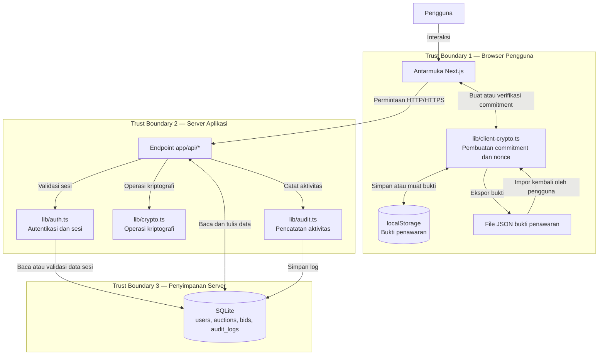

# Architecture and Data Flow — Sealed Bid

## 1. Tujuan

Dokumen ini menjelaskan arsitektur aplikasi Sealed Bid, aliran data antara pengguna dan server, serta batas kepercayaan (*trust boundary*) yang perlu diperhatikan dalam analisis keamanan.

Aplikasi menggunakan antarmuka berbasis Next.js, endpoint API untuk memproses permintaan, modul autentikasi dan kriptografi, serta database SQLite untuk menyimpan data aplikasi.

## 2. Diagram Arsitektur dan Aliran Data

Diagram berikut menggambarkan alur utama aplikasi secara konseptual. Nama komponen dan jalur data perlu dicocokkan dengan implementasi aktual.

## 3. Penjelasan Komponen

| Komponen | Fungsi | Data yang Ditangani |
|---|---|---|
| Browser pengguna | Menampilkan halaman dan menerima interaksi pengguna | Informasi tampilan, input penawaran, dan bukti penawaran |
| Antarmuka Next.js | Mengirim permintaan ke server dan menampilkan hasil | Data akun, lelang, dan status penawaran |
| `lib/client-crypto.ts` | Menjalankan operasi commitment di sisi klien | Nilai penawaran, nonce, dan commitment |
| Endpoint `app/api/*` | Memproses permintaan aplikasi | Data yang dikirim pengguna dan hasil operasi server |
| `lib/auth.ts` | Memvalidasi autentikasi dan sesi | Token atau informasi sesi pengguna |
| `lib/crypto.ts` | Menjalankan operasi kriptografi server | Data terenkripsi, secret, atau nilai hash sesuai implementasi |
| `lib/audit.ts` | Mencatat aktivitas tertentu | Informasi aktivitas keamanan |
| Database SQLite | Menyimpan data aplikasi | Pengguna, lelang, penawaran, dan log aktivitas |

## 4. Aliran Data Utama

### A. Proses Login

1. Pengguna memasukkan kredensial melalui antarmuka aplikasi.
2. Browser mengirim permintaan login ke endpoint API.
3. Server memvalidasi kredensial dan membuat sesi jika autentikasi berhasil.
4. Browser menerima respons autentikasi dan menggunakan mekanisme sesi untuk permintaan berikutnya.

### B. Proses Commit Penawaran

1. Pengguna memasukkan nilai penawaran.
2. Komponen kriptografi di browser membuat nonce dan commitment sesuai implementasi.
3. Bukti yang diperlukan untuk reveal dapat disimpan pada browser atau diekspor sebagai file.
4. Browser mengirim commitment ke endpoint commit.
5. Server memvalidasi permintaan dan menyimpan data penawaran sesuai aturan aplikasi.

### C. Proses Reveal Penawaran

1. Pengguna mengirim nilai penawaran dan nonce yang diperlukan.
2. Server memeriksa autentikasi, status lelang, dan data penawaran.
3. Server memverifikasi apakah nilai dan nonce sesuai dengan commitment yang tersimpan.
4. Jika valid, server memproses hasil reveal sesuai aturan aplikasi.

### D. Penyimpanan dan Audit

1. Endpoint API membaca atau mengubah data melalui database.
2. Aktivitas tertentu dicatat melalui modul audit.
3. Database menyimpan data aplikasi dan catatan aktivitas sesuai implementasi.

## 5. Trust Boundaries

### Trust Boundary 1 — Browser Pengguna

Browser berada di luar kendali penuh server. Pengguna dapat memodifikasi input, mengubah data lokal, atau mengakses file yang tersimpan di perangkatnya.

**Risiko terkait:** pencurian bukti penawaran, manipulasi input, dan perubahan data lokal.

### Trust Boundary 2 — Browser ke Server

Permintaan dari browser memasuki server melalui endpoint API. Semua input yang berasal dari klien harus dianggap tidak tepercaya.

**Risiko terkait:** pemalsuan permintaan, akses tanpa izin, manipulasi parameter, dan penyalahgunaan endpoint.

### Trust Boundary 3 — Server ke Database

Server berkomunikasi dengan database yang menyimpan data penting aplikasi.

**Risiko terkait:** akses database tanpa izin, perubahan data secara langsung, dan kebocoran file database atau cadangan.

### Trust Boundary 4 — Konfigurasi Rahasia

Secret aplikasi harus dibatasi agar hanya dapat diakses oleh proses server yang memerlukannya.

**Risiko terkait:** kebocoran secret, pemalsuan token, dan penyalahgunaan fungsi kriptografi.

## 6. Data yang Dilindungi Secara Kriptografis

| Data | Mekanisme yang Diharapkan | Catatan Keamanan |
|---|---|---|
| Password | bcrypt | Password disimpan sebagai hash, bukan teks biasa. |
| Informasi pribadi tertentu | AES-256-GCM | Perlindungan bergantung pada pengelolaan kunci dan implementasi. |
| Commitment penawaran | SHA-256 | Hash harus diverifikasi terhadap nilai dan nonce saat reveal. |
| Token sesi | JWT HS256 | Keamanan bergantung pada secret yang kuat dan validasi token. |
| Bukti penawaran lokal | Penyimpanan browser atau file JSON | Penyimpanan lokal bukan enkripsi; kerahasiaannya perlu dilindungi secara terpisah. |

## 7. Catatan Validasi Diagram

Diagram ini merupakan model arsitektur untuk analisis keamanan. Sebelum laporan dikumpulkan, pastikan bahwa:

1. Nama endpoint dan fungsi sesuai dengan kode yang benar-benar digunakan.
2. Alur login, commit, dan reveal mengikuti implementasi aktual.
3. Semua komponen penyimpanan dan data sensitif telah ditampilkan.
4. Arah panah menunjukkan aliran data yang benar.
5. Mekanisme kriptografi ditandai hanya untuk data yang benar-benar dilindungi oleh implementasi.

## 8. Kesimpulan

Diagram arsitektur membantu mengidentifikasi komponen yang memproses data penting dan batas kepercayaan tempat ancaman dapat muncul. Diagram ini menjadi dasar untuk memetakan ancaman STRIDE ke komponen aplikasi, menilai risiko, dan menentukan kontrol keamanan yang sesuai.