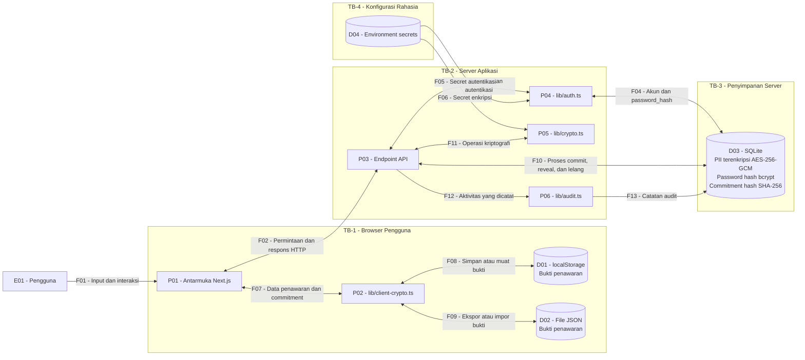

# Data Flow Diagram (DFD) - Aura Secrète (my project)

## 1. Tujuan

DFD ini menggambarkan komponen, aliran data, penyimpanan, dan trust boundary pada aplikasi lelang parfum Aura Secrète dengan mekanisme sealed bid. Setiap elemen memiliki ID agar dapat dirujuk dalam threat model dan risk register.

## 2. Diagram DFD

## 3. Identitas Elemen DFD

| ID | Elemen | Fungsi atau data |
|---|---|---|
| E01 | Pengguna | Menggunakan aplikasi dan mengirim input. |
| P01 | Antarmuka Next.js | Menampilkan halaman, formulir, dan hasil permintaan. |
| P02 | `lib/client-crypto.ts` | Membuat nonce dan commitment di browser. |
| D01 | localStorage | Menyimpan bukti penawaran pada browser. |
| D02 | File JSON | Menyimpan bukti yang diekspor atau diimpor pengguna. |
| P03 | Endpoint API | Memproses permintaan autentikasi, lelang, penawaran, dan administrasi. |
| P04 | `lib/auth.ts` | Memeriksa kredensial dan token sesi. |
| P05 | `lib/crypto.ts` | Mengenkripsi atau mendekripsi informasi pribadi dan menyediakan fungsi commitment hash. |
| P06 | `lib/audit.ts` | Mencatat aktivitas aplikasi tertentu. |
| D03 | SQLite | Menyimpan pengguna, lelang, penawaran, dan log audit. |
| D04 | Environment secrets | Menyediakan secret yang digunakan server untuk autentikasi dan enkripsi. |

## 4. Aliran Data

| ID | Alur | Data utama |
|---|---|---|
| F01 | Pengguna → antarmuka | Kredensial, input lelang, dan penawaran. |
| F02 | Antarmuka ↔ API | Permintaan dan respons aplikasi. |
| F03 | API ↔ autentikasi | Informasi sesi serta pemeriksaan autentikasi. |
| F04 | Autentikasi ↔ SQLite | Informasi akun dan hash password. |
| F05 | Environment secrets → autentikasi | Secret untuk penandatanganan dan verifikasi JWT. |
| F06 | Environment secrets → modul kriptografi | Kunci yang diturunkan dari `ENCRYPTION_SECRET`. |
| F07 | Antarmuka ↔ kriptografi browser | Nilai penawaran, nonce, dan commitment. |
| F08 | Kriptografi browser ↔ localStorage | Bukti penawaran yang disimpan atau dibaca. |
| F09 | Kriptografi browser ↔ file JSON | Bukti penawaran yang diekspor atau diimpor. |
| F10 | API ↔ SQLite | Data akun, lelang, dan penawaran. |
| F11 | API ↔ modul kriptografi | Operasi enkripsi, dekripsi, dan verifikasi commitment sesuai fungsi yang dipanggil. |
| F12 | API → audit | Informasi aktivitas yang perlu dicatat. |
| F13 | Audit → SQLite | Catatan aktivitas aplikasi. |

## 5. Trust Boundary

### TB-1_Browser Pengguna

Browser berada di luar kendali penuh server. Pengguna dapat memodifikasi input, mengubah data lokal, atau memperoleh akses ke file bukti penawaran di perangkat yang digunakannya.

Ancaman terkait meliputi manipulasi input, kebocoran bukti penawaran, dan penggunaan nonce yang tidak aman.

### TB-2_Server Aplikasi

Permintaan dari browser memasuki server melalui endpoint API. Data dari klien harus divalidasi sebelum digunakan untuk operasi yang memerlukan autentikasi, otorisasi, atau perubahan data.

Ancaman terkait meliputi pemalsuan identitas, manipulasi permintaan, penyalahgunaan endpoint, dan akses tanpa izin.

### TB-3_Penyimpanan Server

Database SQLite berada pada penyimpanan yang digunakan aplikasi. Akses langsung terhadap file database atau backup dapat melewati aturan akses yang biasanya diterapkan melalui API.

Ancaman terkait meliputi kebocoran data, perubahan data tanpa izin, dan akses terhadap backup.

### TB-4_Konfigurasi Rahasia

Secret harus tersedia bagi proses server yang memerlukannya dan tidak boleh disimpan sebagai nilai rahasia yang ditulis langsung di kode aplikasi. File `.env.local` tidak boleh diunggah ke repository.

Ancaman terkait meliputi kebocoran secret, pemalsuan token, dan penyalahgunaan kunci enkripsi.

## 6. Aset yang Dilindungi Kriptografi

| ID aset | Lokasi | Mekanisme | Batas perlindungan |
|---|---|---|---|
| A02 — Password pengguna | `users.password_hash` | bcrypt | Hash password bukan enkripsi yang dapat dibalikkan untuk memperoleh password asli. |
| A03 — Informasi pribadi | `full_name_encrypted`, `phone_encrypted`, `address_encrypted` pada `users` | AES-256-GCM | Kerahasiaan dan integritas ciphertext bergantung pada pengelolaan kunci. |
| A04 — Token sesi | Cookie `sealed_bid_session` | JWT HS256 | Memverifikasi integritas token; HS256 bukan enkripsi isi JWT. |
| A07 — Commitment hash | `bids.commitment_hash` | SHA-256 | Memungkinkan verifikasi commitment, tetapi bukan enkripsi nilai penawaran. |
| A08 — Bukti penawaran | localStorage dan file JSON | Tidak dienkripsi secara otomatis oleh media penyimpanan | Nilai penawaran dan nonce perlu dijaga kerahasiaannya sebelum reveal. |
| A09 — Secret kriptografi | Environment secrets | Digunakan untuk autentikasi dan enkripsi | Secret harus dibatasi aksesnya dan tidak dimasukkan ke repository. |

**Catatan penting:** kolom `revealed_amount` dan `revealed_nonce` disimpan dalam tabel `bids` pada implementasi saat ini. Jangan menyatakan kolom tersebut terenkripsi jika kode tidak menunjukkan penerapan enkripsi terhadapnya.

SHA-256 pada commitment tidak menyamarkan nilai penawaran apabila nilai dan nonce diketahui. Karena itu, D01 dan D02 tetap dianggap penyimpanan bukti sensitif, bukan penyimpanan terenkripsi.

## 7. Penggunaan DFD untuk Analisis Ancaman

Setiap ancaman pada `threat_model.md` harus merujuk minimal ke satu ID elemen DFD dan menyebut aset yang terdampak.

Contoh pemetaan:

- Kebocoran bukti penawaran: D01 atau D02; aset A08.
- Kebocoran database: D03; aset A01, A03, A05, A06, atau A11 sesuai data yang terancam.
- Kebocoran secret: D04; aset A09.
- Pemalsuan token sesi: P04 dan aliran F03; aset A04.
- Manipulasi penawaran: P02, P03, atau D03; aset A06, A07, dan A08.

Pemetaan pada contoh ini harus diperiksa kembali terhadap masing-masing ancaman dan jalur data yang benar-benar terlibat.

## 8. Catatan Validasi

DFD adalah model untuk analisis keamanan dan perlu dicocokkan dengan kode yang digunakan saat penilaian. Pastikan nama endpoint, arah aliran, penyimpanan, mekanisme kriptografi, dan data yang dilindungi sesuai dengan implementasi aktual.

Jangan menyatakan suatu kontrol berhasil hanya karena komponen atau fungsi terkait muncul dalam diagram.
