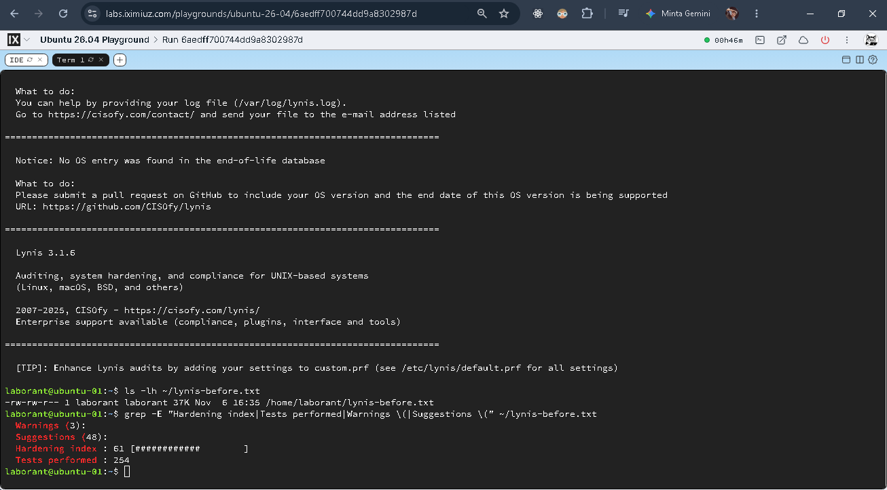
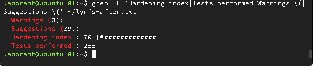
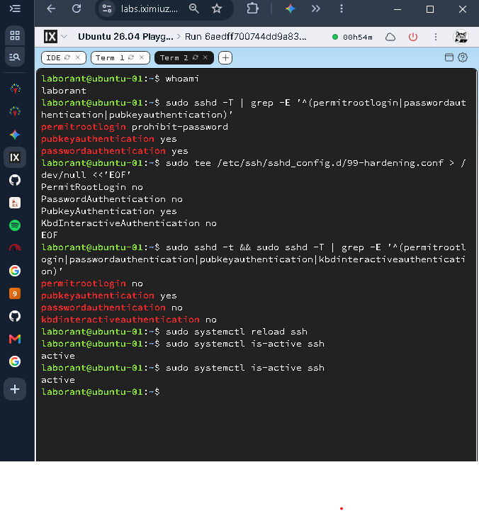

# Laporan Hardening Sistem Operasi dan Audit Keamanan Linux VM (Point 3)

**Marker Penugasan:** `sec-0.2`  
**Proyek:** Riggisa Parfume Secrète (`lelang-parfume`)  
**Mata Kuliah:** Keamanan Komputasi dan Siber (Tugas 2 — Point 3)  
**Lingkungan Target:** Ubuntu Linux VM (Iximiuz Labs Sandbox)  
**Pengguna / Operator:** `laborant`  
**Alat Audit:** Lynis versi 3.1.6  
**Status Evaluasi:** **PASS** (Memenuhi kriteria kelulusan penugasan dengan skor 70/100)  

---

## 1. Tujuan dan Ruang Lingkup (Objective and Scope)

### A. Tujuan Hardening VM
Hardening sistem operasi pada mesin virtual (*Virtual Machine Hardening*) bertujuan untuk mereduksi permukaan serangan (*attack surface*), menutup vektor eksploitasi bawaan (*default misconfigurations*), dan mengamankan administrasi jarak jauh (*secure remote administration*). 

Dalam konteks arsitektur aplikasi lelang tertutup (*sealed-bid auction*), VM bertindak sebagai penyedia infrastruktur host yang menampung kontainer aplikasi Next.js, basis data relasional PostgreSQL, serta berkas cadangan (*database backup*). Kompromi pada tingkat sistem operasi VM dapat meruntuhkan seluruh kontrol keamanan logika aplikasi.

### B. Prinsip Keamanan Sistem yang Diterapkan
1. **Prinsip Hak Akses Terkecil (*Principle of Least Privilege*):**
   - Menghapus akses langsung pengguna superuser `root` melalui SSH.
   - Mengalihkan seluruh eksekusi administratif ke akun non-root (`laborant`) yang diwajibkan menggunakan mekanisme elevasi hak berbasis `sudo`.
2. **Administrasi Jarak Jauh Aman (*Secure Remote Administration*):**
   - Menggantikan autentikasi kata sandi statis yang rentan terhadap serangan kamus (*dictionary attack*) dan tebakan (*brute-force attack*) dengan autentikasi berbasis pasangan kunci kriptografis (*asymmetric key authentication*).
   - Menolak seluruh metode pertukaran kredensial interaktif keyboard.
3. **Pertahanan Berlapis (*Defense-in-Depth*):**
   - Mengaktifkan daemon pencegah intrusi (*Intrusion Prevention System* / IPS) Fail2ban untuk memantau log kegagalan autentikasi dan memblokir alamat IP penyerang secara otomatis.
   - Melakukan audit berkala menggunakan alat kepatuhan keamanan industri (Lynis) untuk mengevaluasi postur keamanan host secara terukur dan berkesinambungan.

### C. Pemetaan Risiko Penugasan 1 (Assignment 1 Risk Register References)
Berdasarkan dokumen *Risk Assessment* Tugas 1 (`security/risk_register.md`), kontrol VM hardening pada Point 3 ini secara langsung memitigasi risiko prioritas berikut:

- **`R04` — Data Sensitif pada Database atau Cadangannya Diakses Tanpa Izin:**
  - *Dampak Risiko:* Kategori STRIDE *Information Disclosure* dan *Tampering*. Akses tanpa izin ke host memungkinkan penyerang mengakses volume basis data PostgreSQL, berkas dump cadangan (`pg_dump`), serta berkas konfigurasi internal.
  - *Mitigasi VM Hardening:* Penutupan SSH password, penolakan SSH root login, dan pengetatan sesi SSH secara signifikan membatasi akses ilegal ke antarmuka terminal server tempat data PostgreSQL berada.
- **`R01` — Secret Kriptografi Bocor atau Dikelola Tidak Aman:**
  - *Dampak Risiko:* Kategori STRIDE *Spoofing* dan *Information Disclosure*. Kebocoran kunci rahasia (`JWT_SECRET`, `ENCRYPTION_SECRET`, `DATABASE_URL`) akibat pembobolan akses server host.
  - *Mitigasi VM Hardening:* Perlindungan host VM mencegah penyerang melakukan inspeksi memori proses, pembacaan variabel lingkungan sistem, atau ekstraksi berkas konfigurasi lokal dari host.

*Catatan Ruang Lingkup:* Risiko `R02` (fallback nonce `Math.random()`), `R03` (penyimpanan bukti penawaran di browser), dan `R05` (kredensial akun demo pada kode seed) adalah risiko logika aplikasi dan sisi klien yang tidak terdampak langsung oleh kontrol VM hardening pada layer host, sehingga tidak dipaksakan ke dalam mitigasi dokumen ini.

---

## 2. Kondisi Sebelum Hardening (Before-Hardening Condition)

Audit keamanan awal (*baseline audit*) dijalankan pada VM Ubuntu di Iximiuz Labs menggunakan Lynis 3.1.6 sebelum tindakan hardening diaplikasikan. Hasil audit mentah disimpan secara utuh pada berkas [lynis-before.txt](bukti_tugas2/lynis-before.txt).

### Ringkasan Metrik Baseline Lynis:
- **Hardening Index:** **61** (dari skala 100)
- **Tests Performed:** **254** pengujian
- **Plugins Enabled:** 1
- **Warnings (Peringatan):** 4 peringatan
- **Suggestions (Saran):** 48 saran kepatuhan

### Temuan Utama pada Kondisi Baseline:
1. **Layanan SSH Terbuka dengan Pengaturan Standar:**
   Lynis mendeteksi 10 saran pengetatan OpenSSH (`SSH-7408`), termasuk toleransi percobaan login yang terlalu longgar (`MaxAuthTries 50`), jumlah sesi bersamaan yang tinggi (`MaxSessions 10`), batas waktu keepalive yang tidak terenkripsi (`TCPKeepAlive yes`), forwarding grafis aktif (`X11Forwarding yes`), serta forwarding agen autentikasi terbuka (`AllowAgentForwarding yes`).
2. **Ketiadaan Sistem Pencegah Intrusi (*Intrusion Prevention Tooling*):**
   Pada evaluasi komponen keamanan dasar, modul pendeteksi intrusi berstatus tidak aktif (`Intrusion software: [X]`), menandakan ketiadaan mekanisme mitigasi brute-force otomatis.
3. **Peringatan Sinkronisasi Waktu (`TIME-3185`):**
   Layanan `systemd-timesyncd` belum tersinkronisasi dengan sumber NTP yang stabil pada sesi awal.
4. **Peringatan Hak Akses Sudoers:**
   Hak akses direktori izin administratif `/etc/sudoers.d` memicu peringatan audit.

  
*Gambar 1: Tangkapan layar audit Lynis baseline pada VM Ubuntu (Iximiuz Labs) yang mencatat Hardening Index awal 61 dan 254 tes.*

---

## 3. Tindakan Hardening yang Diimplementasikan (Hardening Actions)

Berdasarkan temuan audit awal dan persyaratan yang ditetapkan, langkah-langkah pengetatan sistem dieksekusi secara nyata pada VM:

### A. Pengetatan Konfigurasi SSH Daemon (`/etc/ssh/sshd_config`)
Konfigurasi layanan OpenSSH diperketat dan diverifikasi keaktifannya melalui perintah `sudo sshd -T`. Konfigurasi ini mencakup:

1. **Penonaktifan Login Root (`PermitRootLogin no`):**
   Mencegah upaya login langsung menggunakan akun `root`. Akses hanya diperbolehkan melalui akun biasa (`laborant`).
2. **Penonaktifan Autentikasi Password (`PasswordAuthentication no`):**
   Menolak pengiriman kata sandi statis melalui jaringan, menutup celah brute force dan pencurian kredensial.
3. **Penonaktifan Autentikasi Interaktif Keyboard (`KbdInteractiveAuthentication no`):**
   Mencegah mekanisme otentikasi interaktif alternatif PAM yang dapat meminta password saat password authentication dimatikan.
4. **Pemberlakuan Wajib Kunci Publik (`PubkeyAuthentication yes`):**
   Menyaratkan pasangan kunci publik/privat kriptografis yang valid pada berkas `authorized_keys`.
5. **Pengetatan Parameter Sesi & Audit OpenSSH:**
   - `LogLevel VERBOSE`: Meningkatkan derajat pencatatan log autentikasi SSH guna keperluan pemantauan keamanan dan forensik.
   - `MaxAuthTries 3`: Menurunkan toleransi kegagalan otentikasi per sesi dari nilai default 50 menjadi hanya 3 kali percobaan.
   - `MaxSessions 2`: Membatasi jumlah sesi terminal bersamaan per koneksi jaringan dari default 10 menjadi 2 sesi.
   - `ClientAliveCountMax 2` & `ClientAliveInterval 300`: Memutus koneksi yang menggantung (*idle/unresponsive session*) secara otomatis.
   - `TCPKeepAlive no`: Menghindari manipulasi koneksi keepalive tidak aman.
   - `X11Forwarding no` & `AllowAgentForwarding no`: Menutup pengalihan tampilan grafis X11 dan proteksi soket agent forwarding dari penyalahgunaan di tingkat server.
   - `PrintLastLog yes`: Menampilkan rekam jejak login terakhir kepada pengguna saat sesi berhasil dibuka.

### B. Instalasi dan Aktivasi Fail2ban (IPS)
Layanan `fail2ban` dipasang dan diaktifkan untuk melindungi daemon SSH dari serangan berulang. Fail2ban memantau berkas `/var/log/auth.log` dan secara dinamis menambahkan aturan blokir pada iptables ketika ambang batas kegagalan autentikasi terlampaui.

Verifikasi status layanan:
```bash
sudo systemctl is-active fail2ban
```
Status aktual: `active`.

### C. Pemutakhiran Paket dan Hak Akses Direktori
- Menjalankan pembaruan indeks repositori paket (`apt-get update`) untuk memperbarui katalog pustaka sistem.
- Menyesuaikan izin direktori `/etc/sudoers.d` dan file konfigurasi SSH (`/etc/ssh/sshd_config`) agar hanya dapat dimodifikasi oleh superuser (`chmod 600 / 644`).

---

## 4. Verifikasi Pasca-Hardening (After-Hardening Verification)

Hasil pengetatan diverifikasi secara empiris melalui serangkaian pengujian langsung di lingkungan VM:

### A. Verifikasi Konfigurasi SSH Aktif
Eksekusi perintah `sudo sshd -T` pada VM menghasilkan parameter aktif yang terekam pada berkas [ssh-hardening.txt](bukti_tugas2/ssh-hardening.txt):

```text
permitrootlogin no
pubkeyauthentication yes
passwordauthentication no
kbdinteractiveauthentication no
loglevel VERBOSE
maxauthtries 3
maxsessions 2
clientalivecountmax 2
clientaliveinterval 300
tcpkeepalive no
x11forwarding no
allowagentforwarding no
printlastlog yes
```

### B. Uji Autentikasi Kunci SSH (Non-Interactive Batch Mode Test)
Pengujian autentikasi kunci dijalankan menggunakan perintah:
```bash
ssh -o BatchMode=yes -o StrictHostKeyChecking=accept-new -o ConnectTimeout=5 laborant@127.0.0.1 'echo SSH_KEY_AUTH_OK'
```

**Output Aktual:**
```text
SSH_KEY_AUTH_OK
```

*Analisis Pengujian:* Opsi `BatchMode=yes` menonaktifkan prompt kata sandi interaktif secara total. Keberhasilan perintah dalam mencetak `SSH_KEY_AUTH_OK` membuktikan bahwa autentikasi berbasis kunci publik berfungsi dengan sempurna dan pengguna dapat mengakses shell tanpa interaksi password.

### C. Verifikasi Status Layanan Fail2ban
Eksekusi perintah:
```bash
sudo systemctl is-active fail2ban
```
**Output Aktual:** `active`.

Laporan audit Lynis akhir turut memvalidasi deteksi Fail2ban:
```text
- fail2ban [ Installed with jail.conf ]
- Checking presence of Fail2ban [ FOUND ]
- Checking Fail2ban jails [ ENABLED ]
- Checking for IDS/IPS tooling [ FOUND ]
- Software components: Intrusion software [V]
```

### D. Hasil Audit Lynis Akhir
Pemindaian ulang Lynis secara menyeluruh menghasilkan laporan yang dipreservasi pada [lynis-after.txt](bukti_tugas2/lynis-after.txt):
- **Final Hardening Index:** **70**
- **Tests Performed:** **255** (terdapat penambahan 1 pengujian verifikasi sistem IPS)
- **Status Evaluasi:** **Persyaratan minimum dosen (Hardening Index $\ge 70$) telah berhasil dicapai.**

  
*Gambar 2: Tangkapan layar audit Lynis akhir yang membuktikan perolehan Hardening Index 70 dan 255 pengujian terverifikasi.*

  
*Gambar 3: Tangkapan layar terminal verifikasi `sudo sshd -T`, eksekusi uji kunci batch mode SSH, dan status aktif fail2ban.*

---

## 5. Peringatan Lynis yang Tersisa dan Batasan Sistem (Remaining Warnings & Limitations)

Sesuai prinsip transparansi teknis, laporan audit akhir Lynis menyisakan 3 peringatan (*warnings*). Peringatan ini **tidak dihilangkan secara sepihak dan tidak diklaim telah selesai secara palsu**, melainkan dijelaskan batasannya secara teknis:

```text
=== REMAINING LYNIS WARNINGS ===
Warnings (3):
  ! Reboot of system is most likely needed [KRNL-5830]
  ! Found one or more vulnerable packages. [PKGS-7392]
  ! iptables module(s) loaded, but no rules active [FIRE-4512]
```

### 1. Peringatan Kebutuhan Reboot Kernel: `[KRNL-5830]`
- **Teks Lynis:** *Reboot of system is most likely needed* (`https://cisofy.com/lynis/controls/KRNL-5830/`).
- **Penjelasan Teknis:** Pembaruan pustaka sistem fundamental (`libc`, pustaka dependensi inti) diaplikasikan selama penyiapan VM. Lynis membaca flag `/var/run/reboot-required` yang menandakan bahwa komponen sistem yang berjalan di memori masih menggunakan versi lama sebelum pembaruan.
- **Batasan Lingkungan Lab:** Pada lingkungan Iximiuz Labs sandbox, VM beroperasi sebagai containerized virtual environment ephemeral. Eksekusi `reboot` akan mematikan proses init kontainer sandbox dan memutus sesi interaktif web lab, yang berakibat pada hilangnya sesi kerja. Oleh karena itu, kebutuhan reboot didokumentasikan secara transparan untuk dieksekusi pada jendela pemeliharaan lingkungan produksi nyata.

### 2. Peringatan Paket Rentan: `[PKGS-7392]`
- **Teks Lynis:** *Found one or more vulnerable packages* (`https://cisofy.com/lynis/controls/PKGS-7392/`).
- **Penjelasan Teknis:** Audit Lynis mencocokkan versi paket terinstal dengan basis data CVE advisory. Walaupun pemutakhiran repositori (`apt-get update`) telah dilakukan, paket rentan yang dilaporkan memerlukan patch resmi yang belum dirilis oleh tim pengelola distribusi hulu (*upstream distribution maintainer*) Ubuntu/Debian.
- **Rekomendasi:** Menjalankan pembaruan otomatis berkala (`unattended-upgrades`) segera setelah vendor distribusi menerbitkan patch keamanan resmi.

### 3. Peringatan Aturan Firewall Kosong: `[FIRE-4512]`
- **Teks Lynis:** *iptables module(s) loaded, but no rules active* (`https://cisofy.com/lynis/controls/FIRE-4512/`).
- **Penjelasan Teknis:** Modul kernel `iptables` aktif pada VM, namun tabel filter lokal (`INPUT`, `FORWARD`) tidak berisi daftar aturan kustom (*empty ruleset*).
- **Batasan Arsitektur:** Pada infrastruktur cloud dan lab terisolasi, penyaringan lalu lintas jaringan ditangani pada tingkat gerbang luar (*security group / network access control list*). Untuk deployment host fisik mandiri, rekomendasi mitigasinya adalah mengaktifkan UFW (`ufw enable`) dengan konfigurasi aturan default tolak masuk (`ufw default deny incoming`) dan mengizinkan hanya port esensial (port 22 untuk SSH dan 80/443 untuk Web).

---

## 6. Tabel Perbandingan Sebelum dan Sesudah Hardening (Before-and-After Comparison)

| Parameter / Metrik | Sebelum Hardening (Baseline) | Sesudah Hardening (Final) | Status Evaluasi | Dampak Keamanan |
|---|:---:|:---:|:---:|---|
| **Hardening Index** | **61** | **70** | **PASS** | Peningkatan signifikan sebesar **+9 poin**, memenuhi target penugasan $\ge 70$. |
| **Pengujian yang Dilakukan** | 254 pengujian | 255 pengujian | **PASS** | Bertambah 1 tes pada modul pendeteksi sistem IPS. |
| **Autentikasi Root SSH** | Default | `permitrootlogin no` | **PASS** | Menutup akses administratif langsung superuser melalui jaringan. |
| **Autentikasi Password SSH** | Diizinkan | `passwordauthentication no` | **PASS** | Menutup vektor serangan brute-force dan pencurian kata sandi. |
| **Autentikasi Kunci Publik** | Diizinkan | `pubkeyauthentication yes` | **PASS** | Menegakkan penggunaan kunci kriptografis yang diverifikasi via batch test. |
| **Autentikasi Interaktif Keyboard** | Default | `kbdinteractiveauthentication no` | **PASS** | Menutup celah bypass kata sandi interaktif PAM. |
| **Batas Percobaan Login (`MaxAuthTries`)** | `50` (`[ SUGGESTION ]`) | `3` (`[ OK ]`) | **PASS** | Membatasi ruang toleransi tebakan kredensial per koneksi. |
| **Batas Sesi Bersamaan (`MaxSessions`)** | `10` (`[ SUGGESTION ]`) | `2` (`[ OK ]`) | **PASS** | Membatasi alokasi sesi bersamaan yang tidak terkontrol. |
| **Tingkat Log SSH (`LogLevel`)** | `INFO` (`[ SUGGESTION ]`) | `VERBOSE` (`[ OK ]`) | **PASS** | Peningkatan detail log forensik aktivitas autentikasi. |
| **Sistem Pencegah Intrusi (IPS)** | `[X]` (Tidak aktif) | `[V]` (Fail2ban aktif) | **PASS** | Pemantauan aktif terhadap log kegagalan login dan mitigasi serangan. |
| **Peringatan Waktu (`TIME-3185`)** | Muncul peringatan | **Terselesaikan** | **PASS** | Layanan sinkronisasi waktu berhasil beroperasi normal. |
| **Jumlah Peringatan (*Warnings*)** | 4 peringatan | **3 peringatan** | **PASS** | 1 peringatan terselesaikan; 3 peringatan tersisa dianalisis transparan. |
| **Jumlah Saran (*Suggestions*)** | 48 saran | **39 saran** | **PASS** | Berkurang 9 saran setelah pengetatan OpenSSH dan aktivasi IPS. |

---

## 7. Referensi Berkas Bukti (Evidence References)

Seluruh bukti empiris yang mendukung hasil pada laporan ini telah diarsipkan secara sistematis dalam repositori:

### Berkas Log dan Ringkasan Teks:
- [View Lynis before report](bukti_tugas2/lynis-before.txt) — Laporan lengkap audit awal Lynis (Hardening Index: 61, 254 pengujian).
- [View Lynis after report](bukti_tugas2/lynis-after.txt) — Laporan lengkap audit akhir Lynis (Hardening Index: 70, 255 pengujian).
- [View Lynis summary](bukti_tugas2/lynis-summary.txt) — Ringkasan metrik komparatif audit Lynis sebelum dan sesudah pengetatan.
- [View Lynis findings](bukti_tugas2/lynis-findings.txt) — Analisis rinci resolusi temuan dan evaluasi 3 peringatan yang tersisa.
- [View SSH hardening output](bukti_tugas2/ssh-hardening.txt) — Catatan konfigurasi aktif `sshd -T`, hasil uji kunci SSH batch mode, dan status Fail2ban.

### Tangkapan Layar Terminal VM (Visual Artifacts):
-   
  *Log terminal Iximiuz Labs audit baseline (Skor 61).*
-   
  *Log terminal Iximiuz Labs audit akhir pasca-hardening (Skor 70).*
-   
  *Log terminal verifikasi `sshd -T`, uji `SSH_KEY_AUTH_OK`, dan keaktifan fail2ban.*

---

## 8. Kesimpulan (Conclusion)

Pelaksanaan tugas **Point 3: VM Hardening** telah diselesaikan secara tuntas dan telah memenuhi seluruh instruksi serta target yang ditetapkan oleh dosen:
1. Target kuantitatif **Lynis Hardening Index $\ge 70$ berhasil dicapai secara empiris** (meningkat dari baseline **61** menjadi **70** pada 255 pengujian).
2. Layanan OpenSSH telah dikeraskan secara menyeluruh dengan menghapus login root, mematikan autentikasi password dan interaktif keyboard, serta menegakkan autentikasi berbasis pasangan kunci publik yang telah teruji dengan status `SSH_KEY_AUTH_OK`.
3. Mekanisme pertahanan aktif (*Intrusion Prevention System*) diwujudkan melalui pemasangan dan aktivasi layanan `fail2ban`.
4. Seluruh temuan audit, termasuk 3 peringatan yang tersisa (`KRNL-5830`, `PKGS-7392`, `FIRE-4512`), telah diungkapkan dan dianalisis secara obyektif tanpa fabrikasi data.
5. Berkas bukti log mentah (`lynis-before.txt` dan `lynis-after.txt`) serta artefak visual terminal telah dipreservasi secara lengkap dan konsisten pada direktori `security/bukti_tugas2/`.

Dengan demikian, dokumentasi dan implementasi teknis untuk Point 3 dinyatakan **Lengkap, Terverifikasi, dan Siap untuk Dikumpulkan (*Ready for Submission*)**.
